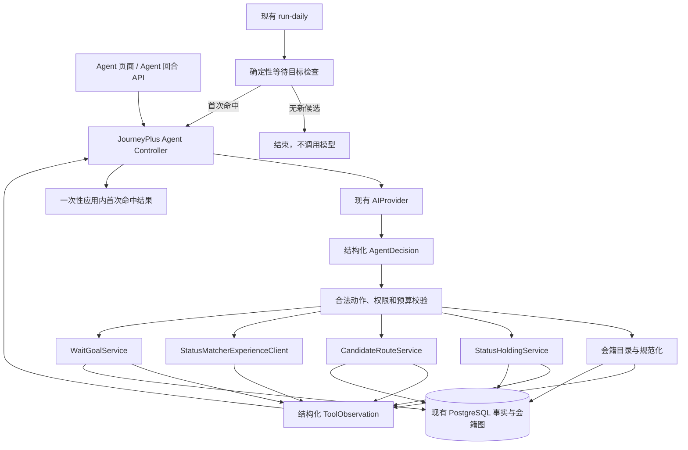

# JourneyPlus 会籍策略 Agent 技术基线

> 2026-09-06 修订：新的产品与技术约束以[统一活动知识与 Agent 基线](./unified-knowledge-agent-baseline.md)及其 OpenSpec 为准。本文以下保留旧版／legacy 实现的范围与历史说明；涉及固定流水线、最短路径单一展示、仅完整候选后调查等冲突规定已被新基线替代，不能据此限制本次实现。正式切换尚未完成。

> 文档状态：旧版 Agent 技术基线，供 legacy 兼容参考。
>
> 产品依据：[JourneyPlus 个性化会籍匹配产品总方针](./personalized-status-match-product-direction.md)与[JourneyPlus 会籍策略 Agent 产品方针](./personalized-status-match-agent-direction.md)。本文只规定这两份产品方针对应的技术实现边界，不扩大产品范围。
>
> 实现状态：本文描述的单 Agent 已由 `openspec/changes/implement-membership-strategy-agent/` 落地，并通过真实 PostgreSQL、真实模型和受控 StatusMatcher 页面验收。当前运行方式以[产品运维说明](./personalized-status-match-product-operations.md)为准，验收记录见[会籍策略 Agent 真实链路验收](./membership-strategy-agent-real-validation-2026-09-04.md)。
>
> 历史关系：`technical-baseline-initial.md` 是泛旅行规划和多 Agent 设想的开工前历史副本，不再作为当前技术决策依据，也不在本文中延续其 LangGraph、多 Agent、OR-Tools、独立 Worker、移动端或完整旅行规划架构。

## 1. 技术结论

JourneyPlus 在现有确定性会籍匹配底座上增加一个面向用户的会籍策略 Agent，整体继续采用 Python 模块化单体、FastAPI、PostgreSQL、SQLAlchemy、Alembic、Pydantic 和现有 OpenAI-compatible `AIProvider`。

Agent 运行时采用 JourneyPlus 自有的薄型、有类型、有上限的 Controller，不引入 PydanticAI、Pydantic Graph、LangGraph 或多 Agent 编排。Controller 只负责把一个用户请求组织为“读取状态、让模型选择下一步、校验动作、执行工具、返回观察结果、继续或停止”的短循环；正式事实、路线、资格、价格、期限、持久化和等待目标检查仍由确定性程序负责。

这项技术方案的核心不是建设通用 Agent 平台，而是给当前产品补上一个受约束的语义决策层：程序确定什么是事实、什么动作当前合法，Agent 根据用户表达和工具结果决定下一步做什么。

## 2. 当前代码技术基线

### 2.1 已运行架构

当前项目是一个 Python 3.12+ 单仓库模块化单体，主要技术组件为：

```text
依赖管理       uv
服务端         FastAPI
结构化契约     Pydantic 2
数据库         PostgreSQL；测试兼容 SQLite
ORM            SQLAlchemy 2
迁移           Alembic
模型访问       自有 OpenAI-compatible AIProvider
外部读取       httpx、selectolax、feedparser
页面           FastAPI 服务端页面壳 + 原生 JavaScript/CSS
测试           pytest
本地数据库     Docker Compose PostgreSQL
每日运行       外部定时器调用 journeyplus run-daily
```

当前不依赖 LangGraph、LangChain、PydanticAI、OR-Tools、pgvector、Redis、Celery、APScheduler、Next.js、React Native 或 LangSmith。

### 2.2 已运行的数据和工作流

现有 AI Workflow 负责来源内容的筛选、结构化事实提取和简报生成。正式事实保留来源、证据、版本、生命周期和冲突状态；模型输出必须经过本地 Pydantic Schema 和确定性业务校验后才能进入正式读取层。

现有确定性产品底座已经提供：

- 规范化会籍目录；
- 用户持有会籍的校验和持久化；
- StatusMatch 官方项目与普通文章映射的来源中立统一图；
- 从多个持有会籍同时出发的完整可达关系；
- 闭环、重复汇合、规则派生关系和 provenance；
- 申请路线、路线价格、地区提示、资格、期限、生命周期、证据和简报；
- 数据库租约、北京时间日桶、运行幂等、处理预算和每日生命周期推进。

### 2.3 当前个性化能力的边界

`PersonalizedMatchService` 仍只根据全部 `StatusHolding` 计算可达图和关联机会，不承担用户本次目标、最高费用、是否接受挑战等取舍，也不在可行路线之间进行个性化选择。新增的 `CandidateRouteService` 在这层事实读取之上按目标和硬条件返回 `matching_routes`、`nearby_routes` 和 `unknown_routes`；`AgentController` 再负责回答“结合我的目标和取舍，现在最值得走哪条路线”。

当前已经运行：

- `/agent` 页面、回合 API 和状态 API；
- 有类型、有上限的 Agent 动作循环和跨确认短期状态；
- 面向目标和硬取舍的事实候选及只偏离一个条件的近似候选；
- 默认关闭、双重授权、最多三条候选和两页的 StatusMatcher 按需经验调查；
- 一个经用户确认的等待目标、每日确定性检查、首次命中恢复和一次性应用内结果。

## 3. 当前总体架构



图中的 Catalog、Holdings、Routes、Experience 和 Wait 都是同一个 Agent 可以调用的普通程序或工具，不是其他 Agent。现有采集、事实提取、统一图和每日自动化继续独立运行，不进入 Agent 推理循环。

## 4. 单 Agent 运行时

### 4.1 Controller 职责

JourneyPlus 自行实现一个小型 `AgentController`。它只承担：

1. 加载本次请求需要的短期结构化状态；
2. 根据当前状态计算允许的 Agent 动作；
3. 调用现有 `AIProvider` 获取结构化决定；
4. 校验动作是否在允许集合内、是否满足授权和预算；
5. 调用对应确定性工具；
6. 把工具结果作为结构化观察交回同一个 Agent；
7. 在需要用户确认或形成最终答案时停止；
8. 保存最小运行状态和必要的审计信息。

Controller 不建设通用 DAG、图节点平台、插件市场、任意工具发现或多 Agent 通信机制。

### 4.2 类型化运行契约

Agent 运行至少具有三类严格的 Pydantic 契约：

```text
AgentState        本次任务目标、已确认信息、当前候选引用和剩余预算
AgentDecision     下一步动作、动作理由和该动作所需的结构化参数
ToolObservation   工具执行结果、失败原因、证据引用和可继续动作
```

动作集合必须与 Agent 产品方针规定的六类动作一一对应：确认理解、追问一个问题、查询路线、调查经验、提出调整、保存等待目标或结束。技术实现可以在同一动作类型内部使用不同结果状态，但不得增加申请、支付、联系项目方、发现新活动或其他越界动作。

模型输出通过 Schema 只代表“动作候选”。只有 Controller 完成权限和业务校验后，动作才可以执行。

### 4.3 运行循环

```text
接收用户输入或等待目标首次命中
→ 构建精简 AgentState
→ 计算当前允许动作
→ AIProvider 返回 AgentDecision
→ 本地 Schema 校验
→ Controller 校验权限、确认状态和预算
→ 执行一个工具或返回用户确认
→ 工具结果形成 ToolObservation
→ 更新 AgentState
→ 再次选择动作，或输出最终结果
```

同一用户 HTTP 回合最多进行三次模型调用。结构化输出修复也计入该上限。达到上限仍不能得出安全结论时，返回明确的暂不可完成状态，不继续循环或扩大搜索范围。

### 4.4 真 Agent 判定

Controller 不能把所有分支预先固定成同一调用链。模型必须能够在程序允许的动作范围内，根据用户表达和 ToolObservation 选择不同下一步：

- 信息明确时直接查询，存在关键歧义时确认；
- 有正式候选时决定是否调查经验或直接推荐；
- 无正式候选时从近似候选中选择一个最小调整；
- 用户拒绝调整或按调整条件仍无正式候选时，主动询问是否按当前条件持续跟进；
- 用户明确同意持续跟进时，请求保存等待目标；
- 等待目标首次命中时根据新候选重新组织建议。

如果实现始终固定执行“自然语言解析、查询、生成文案”，则属于 AI Workflow，不满足本文的 Agent 基线。

## 5. 为什么不采用通用 Agent 框架

当前 Agent 只有一个、动作集合封闭、每次候选很少、运行回合很短，而且跨用户确认、正式写入、等待目标和每日恢复无论使用什么框架都必须由 JourneyPlus 自己管理。现有 `AIProvider`、Pydantic 校验、测试 Provider 和模型预算机制已经覆盖大部分基础能力。

因此当前基线明确不引入：

- PydanticAI Agent 运行时；
- Pydantic Graph；
- LangGraph 和 Checkpoint；
- OpenAI Agents SDK；
- LangChain 预制 Agent；
- 多 Agent、子 Agent 或 Agent 间消息机制。

不使用框架不影响 Agent 的真实性。Agent 的本质是基于状态和观察结果自主选择下一步，而不是使用某个带有 Agent 名称的库。

## 6. Agent 与确定性程序的职责

### 6.1 Agent 负责

- 理解自然语言中的已有会籍、目标和费用/挑战取舍；
- 判断是否存在会改变规范化、持久化或查询结果的关键歧义；
- 必要时提出一个最关键的确认问题；
- 根据确定性候选和用户取舍选择一个首选及最多两个差异化备选；
- 判断哪些最终候选值得调查 StatusMatcher 经验；
- 根据经验观察调整多个可行候选之间的呈现顺序；
- 无解时从程序给出的近似候选中选择一个最小条件调整；
- 用户明确同意时请求保存一个等待目标；
- 组织有依据、可解释的最终建议和风险说明。

### 6.2 确定性程序负责

- 会籍目录、别名、项目和等级规范化；
- 持有会籍正式校验和持久化；
- 当前有效映射、完整路径和可达性；
- 资格、费用、挑战要求、地区、期限和生命周期；
- 证据、冲突和来源追溯；
- 硬条件筛选、候选生成和单条件近似候选；
- Agent 合法动作、工具权限、调用上限和停止条件；
- 等待目标正式持久化、确定性检查和通知去重；
- 所有正式数据库写入。

Agent 不得以模型推断覆盖这些结果。

## 7. 确定性候选路线查询能力

在现有 `UnifiedMembershipTreeService` 和事实读取层之上增加一个来源中立的 `CandidateRouteService`，不建立第二套会籍图，也不重复保存传递边。它只回答哪些路线满足条件、偏离什么条件或因什么信息无法判断，不替 Agent 推荐路线。

查询输入只包含本次需要的结构化条件：

- 已确认的持有会籍；
- 目标项目、等级或联盟；
- 用户明确不愿放宽的费用和挑战条件；
- 用于 Agent 后续取舍的免费、低成本、少挑战或路线简单等偏好。

查询输出分为：

```text
matching_routes   满足目标和全部硬条件的正式候选路线及其事实
nearby_routes     只偏离一个用户条件的近似路线及明确的偏离原因
unknown_routes    因关键事实缺失而不能安全判定的路线及未知项
```

硬条件由程序过滤，成本、步骤、挑战、期限和证据引用随路线返回。Agent 负责根据用户表达的主观取舍选择首选与备选；程序不生成主观推荐、不决定展示顺序，也不生成不可解释的万能分数。

不引入 OR-Tools、整数规划、向量搜索或机器学习排序。当前问题规模使用普通图遍历、条件过滤、稳定比较和确定性近似查询即可。

## 8. 自然语言确认与持久化

自然语言理解只产生候选理解，不能直接产生正式 `StatusHolding`。

处理规则为：

1. Agent 从自然语言形成已有会籍、目标和取舍的结构化候选；
2. 目录服务尝试解析项目和等级；
3. 无法唯一解析或用户表达存在关键歧义时，Agent 只提出一个确认问题；
4. 用户确认后，Controller 调用现有 `StatusHoldingService`；
5. `StatusHoldingService` 再次执行目录校验并负责正式写入；
6. 未确认、未唯一解析或目录不存在的会籍不得落库。

目标和普通取舍默认只存在于本次短期交互状态中。只有用户明确选择等待时，才把确认后的目标保存为一个等待目标。

## 9. StatusMatcher 经验调查工具

### 9.1 技术定位

StatusMatcher 实现为 Agent 的独立、按需、只读 `StatusMatcherExperienceClient`，不实现为 `SourceAdapter`，不进入 `SOURCE_REGISTRY`，不参与 `run-daily` 的常规来源采集，也不恢复已经移除的 `statusmatcher_reports` 批量来源。

### 9.2 调用前置条件

Controller 只有在以下条件全部满足时才向 Agent 暴露该工具：

- 已取得书面许可、授权接口或其他明确使用授权；
- 确定性程序已经返回至少一个正式候选；
- 调查对象属于一个首选或最多两个差异化备选，或者用户明确询问该候选；
- 本次调用仍在数量和时间预算内。

没有正式候选、没有授权或候选超过限制时，模型看不到可执行的经验调查动作。

### 9.3 输入和输出边界

工具只接收可比路线所需的规范化来源项目、来源等级、目标项目和目标等级。优先调查最近十二个月，样本不足时最多扩展到二十四个月；多步路线分别调查各申请步骤。

工具只返回结构化观察：

- 可比报告数量；
- `Match`、`Challenge`、`Deny` 和无法判断的观察数量；
- 反复出现的材料、等待时间或拒绝原因；
- 来源链接、观察时间和证据是否充足；
- `较强 / 一般 / 较弱 / 证据不足 / 暂不可用` 信号。

工具不得把观察比例称为真实审批成功率，不得把单个案例概括为常见规律，不得把社区经验写入官方事实、生命周期或统一会籍图。

### 9.4 保存和失败

不长期保存报告正文、页面镜像或搜索结果全文。请求失败、无可比报告、授权不可用或证据不足时，工具返回明确的降级结果，Agent 继续使用 JourneyPlus 正式事实完成推荐，不转向全网搜索。

## 10. 等待目标与每日恢复

系统只允许一个当前等待目标，并且只有走完产品方针规定的“无方案、一次调整、仍无方案或用户拒绝调整、Agent 主动提出持续跟进、用户明确同意”流程后才能创建。

等待目标由确定性 `WaitGoalService` 管理，支持读取、确认后的保存、修改、取消和结束。普通查询、临时假设、未确认的 Agent 理解和被拒绝的条件调整不得创建等待目标。

现有 `run-daily` 在完成来源处理和生命周期推进后增加一个确定性检查步骤：

```text
读取当前有效等待目标
→ 使用 CandidateRouteService 查询
→ 没有新正式候选：结束，不调用模型，不通知
→ 出现候选：计算候选签名并检查是否已通知
→ 首次命中：恢复一次同一个 Agent
→ 授权可用时按需调查 StatusMatcher
→ 生成一次应用内通知并记录去重状态
→ 用户接受、取消或不再等待时结束目标
```

等待目标是无方案分支的一种正式结果，而不是独立的提醒功能。完整交互顺序为：候选查询无结果后，Agent 从 `nearby_routes` 中只提出一个最小调整；用户确认后重新查询。用户拒绝调整，或者调整后仍没有 `matching_routes` 时，Agent 必须主动询问是否按当前条件持续跟进。用户只需确认、修改或拒绝；只有明确确认后程序才写入 `WaitGoal`。

不为这一能力增加 APScheduler、消息队列、事件总线、Transactional Outbox 或独立 Worker。每日任务仍由当前外部调度入口触发，长期状态继续保存在 PostgreSQL。

## 11. 数据和状态边界

### 11.1 继续复用

- `StatusHolding`：用户明确确认的当前持有会籍；
- 现有来源、文档、事实、证据、机会、简报和生命周期记录；
- 现有统一会籍图读取投影；
- `AnalysisRun`、`AutomationRun` 和当前幂等机制。

### 11.2 最小新增

只增加两个业务所需概念：

1. **短期 Agent 交互状态**：保存待确认的结构化理解、当前动作、候选引用、预算和过期时间，用于用户确认后恢复。它是运行状态，不是长期用户记忆。
2. **一个等待目标**：保存用户明确确认的目标和硬取舍，以及当前状态、首次命中和通知去重所需信息。

短期状态到期后应清理。默认不长期保存完整用户输入、完整聊天历史、模型思维过程、未确认会籍、普通查询目标、被拒绝调整或 StatusMatcher 报告正文。

不引入 `TravelerProfile`、积分余额账户、权益资产、旅行目标、策略图、计划版本、资产占用、行动中心或通用监控规则。

## 12. 模型和 Prompt

### 12.1 Provider

Agent 复用现有 `AIProvider` 协议和 OpenAI-compatible 服务端配置，不建立第二套模型客户端。模型、供应商、端点和凭证继续只存在于服务端配置中。

Agent 是否完成以行为验收为准，而不是以某个模型名称为准。实际配置的模型必须稳定通过动作选择、结构化输出、中文会籍理解和停止边界验收；没有通过时，Agent 能力不得标记为可用。

### 12.2 Prompt 和输出

Agent Prompt 保存在代码仓库并显式版本化，至少包含：

- 当前任务和产品知识边界；
- 当前允许动作；
- 不允许的动作和正式事实权限；
- 本次结构化状态和工具观察；
- 候选数量、调用次数和停止条件；
- StatusMatcher 的授权和表达限制；
- 输出 Schema。

每次模型决定都经过 Pydantic Schema 校验和业务语义校验。JSON 合法不代表动作合法；工具权限、用户确认、正式候选范围和写入条件必须由 Controller 二次校验。

## 13. API 与页面

继续使用当前 FastAPI 应用和原生 JavaScript/CSS，不建立独立前端仓库或移动端。

目标产品增加：

```text
/agent                         会籍策略 Agent 页面
POST /v1/agent/turn            提交自然语言、确认或修改，返回下一动作或结果
GET  /v1/agent/state           读取短期交互、当前等待目标和待展示的首次命中结果
```

具体请求和响应使用 Pydantic 定义，并由 FastAPI 生成 OpenAPI。`POST /v1/agent/turn` 使用同步、受限的短回合：返回待确认理解、一个关键问题、推荐结果、一个调整建议、持续跟进确认或明确失败状态；确认、修改或结束等待目标也通过该回合接口表达，不另建一组专用命令接口。

前端只负责采集用户输入、呈现结构化回合状态和提交用户选择，不在 JavaScript 中复制目录解析、路线过滤、Agent 动作判断、StatusMatcher 调研或等待目标规则。服务端 API 是前后端之间唯一的业务边界，即使页面继续和 FastAPI 同仓部署，也保持职责分离。

不引入异步 Run API、SSE、WebSocket、长任务进度图或移动推送。StatusMatcher 调查使用明确的连接和总超时，失败时返回降级结果，不让 HTTP 请求无限等待。

现有 `/holdings`、`/matches`、`/briefs`、机会详情和相应确定性 API 保持无模型调用；Agent 是新增入口，不改变这些页面的确定性性质。

## 14. 复杂度、预算与失败边界

每个用户请求强制执行：

- 最多提出一个当前最关键的问题；
- 最多三次模型调用，输出修复计入上限；
- 只研究一个首选和最多两个备选；
- 无方案时只提出一个最小调整；
- 只允许一个当前等待目标；
- StatusMatcher 失败时不扩展为全网调查；
- 等待目标没有新候选时不调用模型；
- 达到预算、权限不足或结果无法安全确认时明确停止。

外部工具必须设置域名白名单、超时、响应大小限制和结构化输出限制。模型不得自行生成 URL 绕过工具访问策略。

## 15. 可观测性与评测

### 15.1 最小运行记录

Agent 运行只记录排查和复现所需的精简信息：

- 运行和交互标识；
- Agent、Prompt、Schema、Provider 和模型版本；
- 结构化动作序列；
- 调用的工具名称和成功/降级状态；
- 模型调用数、耗时和错误；
- 最终引用的候选和证据标识；
- 是否等待用户、完成或达到停止条件。

默认不记录模型思维过程、完整聊天文本或 StatusMatcher 报告正文。不把 LangSmith、Logfire 或其他外部追踪服务设为必需组件。

### 15.2 测试层次

1. **确定性单元测试**：目录解析、硬条件、候选、近似候选、等待目标和通知去重。
2. **Controller 状态测试**：合法动作集合、确认门、写入门、循环上限和失败降级。
3. **模拟 Agent 测试**：复用或扩展 `SequenceAIProvider`，精确回放动作和工具观察。
4. **真实模型验收**：使用固定样例验证自然语言理解、动作选择、中文表达和边界遵守。
5. **外部工具契约测试**：只使用许可范围内的固定响应或受控请求，验证样本分类和降级。

必须覆盖这些分支：

- 信息充分，直接查询；
- 会籍或目标存在关键歧义，提出一个问题；
- 用户确认后才持久化；
- 有候选且无需经验调查；
- 有候选且授权后调查经验；
- 无授权或调查失败时降级；
- 无候选时提出一个最小调整；
- 用户拒绝调整后不继续降低要求；
- 用户明确同意后保存等待目标；
- 等待目标无命中时零模型调用；
- 首次命中只通知一次；
- 模型尝试越权动作时被 Controller 拒绝。

## 16. 安全、隐私与合规

- API Key、外部授权和数据库凭证只保存在服务端；
- 模型无 SQL、数据库 Session 或任意网络访问权限；
- 工具只暴露完成当前动作所需的最少参数和结果；
- 所有正式写操作必须由 Controller 和业务服务重新校验；
- 用户确认不能由客户端伪造的历史消息替代；
- 不保存会员号、证明材料或其他完成路线推荐不需要的敏感数据；
- StatusMatcher 未取得明确授权时，产品中禁用自动调查；
- 社区自报经验不得表述为官方规则或通过保证；
- Agent 不提交申请、不支付费用、不发送材料、不联系项目方。

## 17. 建议代码边界

在现有 `src/journeyplus` 内增加少量模块，不拆仓库和部署：

```text
agent/
  contracts.py        AgentState、AgentDecision、ToolObservation
  controller.py       有限循环、动作权限、预算和停止
  prompts.py          版本化 Agent 指令和上下文构建
  service.py          面向 API 和每日恢复的应用服务
  statusmatcher.py    授权门控的按需经验调查工具
  waiting.py          一个等待目标、确定性检查和去重

product/
  candidate_routes.py 目标查询、硬条件过滤和单条件近似查询
```

模块名称可以在实施 OpenSpec 中按现有包结构调整，但以下边界不得改变：

- Agent 不直接依赖来源采集实现；
- Agent 不直接拼装或修改统一会籍图；
- 候选路线查询是来源中立的确定性读取层，且不替 Agent 做主观推荐；
- StatusMatcher 调查不进入来源注册表；
- 等待目标检查不依赖模型；
- 所有业务写入仍由普通服务完成。

## 18. 技术验收标准

技术实现完成必须同时满足：

1. 同一 Agent 能根据不同输入和工具结果自主选择六类允许动作中的下一步；
2. 动作、状态和工具结果均经过 Pydantic 类型校验；
3. Controller 在代码层强制权限、确认、候选和调用上限，而不是只依赖 Prompt；
4. 未确认或目录无法唯一识别的会籍不能写入 `StatusHolding`；
5. 路径、资格、价格、期限和生命周期完全来自现有确定性底座；
6. 候选路线查询能分别返回正式候选、只偏离一个条件的近似候选和因关键事实不足而无法判断的路线；
7. Agent 默认只展示一个首选和最多两个差异化备选，并能引用用户取舍和正式事实解释；
8. StatusMatcher 只有在授权且存在最终候选时可调用，并且失败可以安全降级；
9. 普通查询不产生长期会话记忆；
10. 等待目标只有用户明确确认后才能保存，且同时最多一个；
11. 每日检查无命中时不调用模型，首次命中时只生成一次通知；
12. 原有四个确定性页面和 API 保持无模型调用；
13. 不引入 PydanticAI、LangGraph、多 Agent、OR-Tools、pgvector、事件总线或独立 Worker；
14. 分支验收能够证明实现不是“固定查询加生成文案”的伪 Agent；
15. 现有采集、事实、会籍图、简报、每日自动化和测试不得因 Agent 接入发生语义回归。

## 19. 与历史技术基线的关系

| 主题 | 历史 `technical-baseline-initial.md` | 当前技术基线 |
|---|---|---|
| 产品范围 | 完整常旅客体验和旅行规划 | 会籍匹配与挑战策略 |
| Agent | 五个逻辑 Agent | 一个受约束 Agent |
| 编排 | LangGraph | 自有薄型 Controller |
| 求解 | OR-Tools | 图遍历、条件过滤和单条件近似查询；Agent 负责主观取舍 |
| 用户状态 | TravelerProfile、资产、TripGoal、Plan | StatusHolding、短期交互、一个等待目标 |
| 长期记忆 | 偏好、计划、反馈和语义检索 | 不保存完整会话，只有确认后的最小状态 |
| 采集 | 广泛第三方研究 | 现有来源 Workflow；StatusMatcher 仅按需经验调查 |
| 调度和事件 | APScheduler、Outbox、Worker | 现有外部每日入口、数据库租约和幂等 |
| API | 异步 Run、SSE、WebSocket | 同步受限 Agent 回合 |
| 客户端 | Next.js + React Native | 当前 FastAPI 页面 + 原生 JavaScript/CSS |
| 部署 | Web、API、Worker、PostgreSQL、移动端 | 当前产品服务、PostgreSQL、每日 CLI |
| 观测 | LangSmith | 本地精简运行记录和 pytest 验收 |

历史基线中仍适用的原则只有：服务端保存密钥、模型输出结构化校验、LLM 不负责精确事实和正式写入、业务状态持久化、来源可追溯、运行有预算和幂等、实现保持模块化单体。其他与当前产品方针冲突的架构不再继承。
