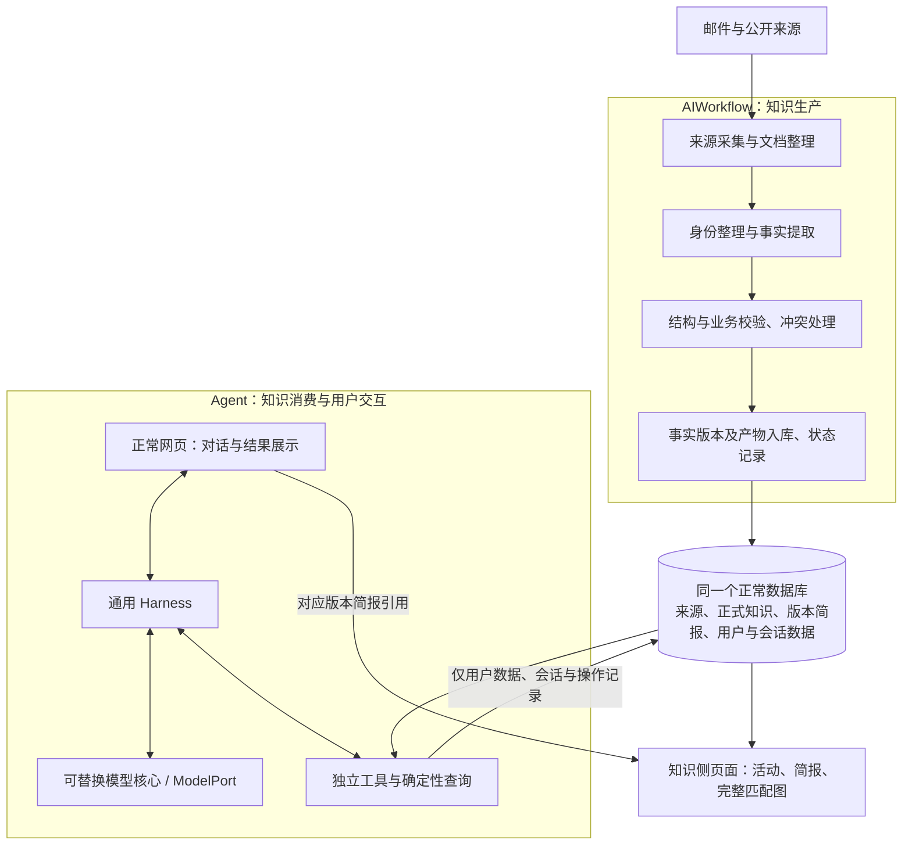

# JourneyPlus 目标架构与模块职责

状态：持续维护的目标架构；当前 AIWorkflow 数据模型已选定，已开展适配与分项验收，整体目标仍须逐项验证。日期：2026-09-09；最近修订：2026-09-12（明确采用当前 AIWorkflow 模型，保留业务数据，按现有架构增量修复）。

本文件依据用户最新方针定义长期架构与模块职责，是目标架构的核心正文，统一维护于 `doc/target-system-architecture.md`。旧 OpenSpec change、设计和审计保留为历史参考，不自动成为当前实施要求。当前工作以保留既有 AIWorkflow 生产链路、采用已选数据模型和逐项修复消费者为基础，不能把本文目标写成当前已经实现的事实，也不能沿用已撤回的清库重建安排。

## 1. 唯一总体方针

**Agent 和 AIWorkflow 是两个大板块，中间共用一个数据库联通。AIWorkflow 负责生产并储存数据，其附属产物是简报和完整匹配图；Agent 负责消费数据，并允许引用对应简报。**

两个板块职责独立，可分别运行、测试和修改。可以由同一个产品进程装配，也可以独立启动；不因此增加微服务、消息队列或第二套业务数据库。数据库是共享数据边界，不是共享任意内部状态的理由。

**当前正式业务模型采用 AIWorkflow 已有的产出结构**：官方活动使用 `status_events`、`fact_sets`、`briefs`，普通文章使用 `article_analyses`、`article_opportunities`、`article_briefs`，来源及文档快照继续归档。这些结构不再称为等待淘汰的“旧模型”；此前另建的统一知识表体系已经弃用，不作为后续恢复目标。

“统一”指消费者使用同一事实来源、稳定的读取语义和一致的版本关联，不要求所有来源使用同一组物理表。不同来源可保留必要的生产结构，由共享读取层确定性整理为目录、活动详情、路线和展示结果；这种读取投影不构成另一套权威业务事实。

数据库中的原始资料、采集与处理中间记录、正式知识和用户记忆有不同用途，可以合理分层；“干净”不等于全部压进一张表。禁止为了兼容旧实现而长期维护两套含义相同的权威业务事实。

## 2. AIWorkflow：生产职责

| 模块 | 输入与输出 | 必须承担的职责 | 边界 |
|---|---|---|---|
| 来源管理与采集 | 邮件/订阅/官方页面 → 来源项、原始文档快照及采集记录 | 读取邮件发现活动；获取并归档官方资料与文章；去重、抓取状态和时间记录 | 不删除源邮箱邮件；不接收 Agent 的隐式采集任务 |
| 文档整理 | 原始快照 → 规范正文及按需分段 | 保留原文快照、规范正文、来源标识及链接、可获得的发布时间和抓取时间；分段服务于提取，不要求建立逐条事实的精确定位 | 整理不擅自改变事实，不把网页指令当系统指令 |
| 身份整理与提取 | 整理后的内容 → 活动、项目/等级、方案及事实草稿 | 区分不同活动期次，提取映射、费用、条件、时间及申请链接，保留原文链接 | 直接使用当前 AIWorkflow 产出结构，不再转换并持久化为弃用模型中的另一套同义事实 |
| 知识校验 | 事实草稿 → 可发布结果或明确待处理原因 | 检查结构、身份关联、费用/条件适用范围、未知项和冲突；不要求结构化字段逐条回到原文校验 | 未知不等于免费或不存在；失败不污染当前发布版本 |
| 简报与图数据 | 同一份已校验事实 → 版本简报及确定性图数据 | 简报表达与结构化事实一致；完整图使用相同版本的映射和条件 | 简报和图不是第二套独立事实来源，不重新猜费用/资格 |
| 版本入库与就绪状态 | 已校验事实及对应产物 → 可消费版本与明确状态 | 用短事务维护版本关联、当前指针和各阶段处理结果；按明确的业务就绪条件开放读取 | 不把部分产物完成标成全部就绪；不持有数据库事务等待模型/网络；不要求额外的旧知识发布服务 |
| 调度与维护 | 显式任务 → 采集/处理/发布状态 | 增量更新、失败重试、幂等与资源控制；明确维护命令 | 与 Agent 的对话执行循环、模型配置分开 |

### 生产过程

来源读取 → 文档规范化 → 必要的身份/事实整理与校验 → 当前模型的版本入库；简报和确定性图数据依据对应事实版本生成或计算，并检查一致性。

StatusMatch 官方页面监控将结束判断与内容变更分开：页面是否表示活动结束只判断首页，不检查 FAQ/Terms 的结束措辞，也不据此标记页面状态不一致。首页明确结束时归档并跳过其余页面；首页未结束时，首页、FAQ、Terms 都检查内容变更并保留文档版本。页面请求失败仍按采集错误处理。已提取的明确截止日期继续由时间生命周期规则判断。

以上为职责关系，不规定新增处理阶段或重新编排已有生产链路。本文中的“发布”指当前模型中的版本可消费及其状态管理，不指向已弃用的 `knowledge-refresh` 服务，也不要求额外的转换模型调用。事实可读取、简报生成中、产物失败等状态应分别表达；是否必须等简报完成才开放该事实版本，由具体业务就绪规则确定，本架构不额外强制“所有产物一次性完成才可读”。无论采用哪种规则，都不能把未完成产物标为成功，或用旧简报冒充新事实版本的简报。

原文归档与逐条事实证据分开处理：采集取得的原始 HTML、邮件及文章内容以文档快照留档，同时保留规范正文、来源标识与链接、时间和版本信息，供重处理、排查和增量更新使用。提取记录关联所使用的文档版本即可，不要求为每条费用、资格或映射另外保存逐字引文、字符位置、证据 ID 或精确来源绑定。正式知识以提取后的结构化事实为核心；缺少逐条证据或精确引用本身不阻止发布，原文归档、结构与业务校验、未知项和冲突处理仍须成立。用于提取的章节可按实际流程需要保留，不承担逐条证据索引义务。

申请链接、活动官网链接及原文链接仍须保留，供用户访问、申请及查看原始资料；未取得的链接明确缺失，不凭空生成。取消的是结构化字段逐条与原文进行匹配、核验及精确引用的要求，不是链接字段或原文归档。字段类型、实体关联、方案与费用适用关系、内部一致性等校验继续保留，不以引文匹配、证据 ID 或原文定位作为结构化字段通过校验的条件。

费用沿用当前 FactSet：`application_routes.prices` 保存明确的金额、币种、适用等级和可用性，正文提取与程序表格解析使用相同字段。`cost` / `route.cost` 用于补充退款、额外收费条件或尚未结构化的费用文字；已有价格时不要求再生成价格摘要，没有补充信息可为空。费用由共用读取规则结合结构化价格及费用说明判断，不依赖逐字段证据。明确免费或没有费用信息时按免费处理；明确收费但金额不明、费用冲突或适用性不明仍保留具体说明，不把这些情况当成信息缺失。简报直接使用各路线的结构化价格，保留补充说明，不跨币种拼接区间，也不把条件费用推广或相加成通用总价。此分工不新增字段、生产阶段或模型调用。

受管 StatusMatch 的 HOME + FAQ + TERMS 提取采用“程序表格底稿 + 正文补充”：完整价格和等级映射按列名与数据行紧凑传入同一次模型调用，已确认覆盖的表格行从该次正文输入中移除，标题、脚注、正文和未覆盖内容继续保留。原文快照不修改。模型用本次底稿的短编号输出需修改的字段，程序保留未提及的字段与行，更新中的 null 同样表示保留，只有明确列入 clear_fields 的可选字段才清空；同一方案可按正文拆分，正文独有的方案或映射另行新增，不依靠名称翻译或别名字典关联补充。编号及补充格式属于提取过程，最终仍写入现有 FactSet，不新增正式知识字段或表。

这项底稿机制仅用于 StatusMatch 官方三页链路，不改变 LoyaltyLobby 普通文章的标题筛选、正文理解或简报流程。官方正常调用预算为 1 次：同次提取同时输出活动标题和概要，不再另调模型生成简报；引用不存在的底稿编号或补充后结构不合法时，使用原有提取纠错重试，不新增独立模型阶段。

必要的阶段化处理和中间记录可以保留。是否重复提取要根据输入、输出、消费者及实际调用判断，不能仅因为有多个步骤或用了早期表名就删除。现有可复用算法应保留，不为了“全新”重写已经正确的能力。

“直接生产最终结构”的含义是将当前 AIWorkflow 产出作为正式事实：允许草稿、处理任务、按来源区分的表、版本记录和确定性读取投影，不要求生产逻辑直接输出每种 Agent 工具或页面的返回格式。不允许将同一事实再转换成可独立维护的新权威副本；每个中间产物都应能说明它的必要职责。

已有来源未变化时可以复用结果；资料变化时产生新版本。提取/校验/简报失败必须有明确状态，不能将“采集成功”当成“正式知识更新成功”。旧的有效发布版本可继续读取，页面明确资料时间和更新状态。

### 简报与完整匹配图

- 均归知识生产侧所有，通过独立知识页面提供；停止 Agent 或禁用其模型时仍可使用。
- 简报绑定正式知识版本。官方活动的标题和摘要由首次提取根据当前正文同时给出，标题只标明匹配项目，摘要概述活动核心内容，不展开等级对应、地区价格或个人资格判断。程序完成事实合并校验后，将文案绑定实际 FactSet 版本保存；不要求模型输出版本 ID、字段引用或逐条引文，打开简报不临时触发模型生成。
- 简报展示标题、摘要、和我的关系、完整映射表、价格表、付费／免费状态、申请入口、来源链接和简报更新时间。表格读取同版最终事实；免费、付费、混合及费用待确认由程序区分，条件费用不当成通用基础费。相关条件留在表格说明和事实详情中。
- 个人关系使用当前持久化且未明确过期的会籍与既有匹配图计算，区分未保存会籍、无有效会籍、直接路径、间接路径、未找到路径及检索不完整。地区只作为适用范围和价格说明，不作为硬筛选，不因用户地区不匹配而排除路径；不同地区价格分别保留，不跨地区混用。有路径不代表已满足所有申请条件。会籍变化不重写公共简报，也不改变其更新时间。
- 首次模型结果先缓存，事实、简报及当前指针在同一发布事务中保存；保存失败可复用提取结果重试，不再次调用模型。保持现有数据库表结构和事实／原文归档，不新增简报数据表。普通文章仍保留其现有独立正文理解及简报调用。
- 完整匹配图是正式知识的确定性投影，不是 Agent 临时选择的几条路径。可以按已发布快照计算；有缓存时须绑定版本，不能维护另一份可独立修改的图事实。
- “完整”限定于当前已记录、可计算的匹配关系及明确的查询范围，不代表覆盖全部现实机会，也不代表个人申请资格已经自动证明。仅以文字说明的条件、缺失的来源映射或目录元数据，以及搜索资源限制，应明确披露；不为补齐图而要求 AIWorkflow 改写所有条件或增加强制结构化字段。
- Agent 查询路径与完整图使用同一套确定性知识查询/图算法，不各写一套资格和费用判断。Agent 可以选择、比较、展示子集，不能修改图的正式事实。

## 3. 共用数据库：数据域与读写边界

一个正常数据库，以已选定的 AIWorkflow 业务表和当前 Agent 运行表为基础，按职责组织逻辑数据域。下列数据域不与物理表一一对应，不要求重建表、增加存储系统或为 Agent 另造一套业务模型。

| 数据域 | 内容 | 写入方 | 读取方 |
|---|---|---|---|
| 来源与处理记录 | 来源、邮件关联、原文快照、规范正文、文档版本、按需保留的章节、采集状态、处理任务、草稿、错误/冲突 | AIWorkflow / 显式维护 | AIWorkflow；知识侧页面和 Agent 工具可按需只读相关归档，处理中间记录不默认进入模型上下文 |
| 会员目录 | 从现有资料、映射及元数据整理出的项目、等级与别名 | AIWorkflow 维护来源数据；共享读取层确定性整理目录 | AIWorkflow、知识侧页面、Agent 工具 |
| 正式知识 | 活动及期次、版本、申请方案、申请链接、活动官网及原文链接、来源会籍到目标会籍的映射、费用和条件、有效期 | AIWorkflow 按当前模型入库并维护版本状态 | 知识查询服务、简报/完整图、Agent |
| 知识产物 | 版本简报、必要的图缓存/索引 | AIWorkflow / 确定性知识投影 | 知识侧页面与 Agent 的引用/展示 |
| 用户业务数据 | 真实会籍、明确设置的等待任务、操作回执/记录 | 显式用户操作，经用户数据服务 | 用户页面、Agent 工具、确定性等待检查 |
| Agent 会话 | 消息、调用、临时结果、笔记、焦点、运行状态、受控审计记录 | Agent 运行与交互层 | 对应会话及审计/恢复能力 |

会员目录可以是共享读取层的投影；不强制新建项目、等级、别名表或将现有会籍名称键改成外键。缺失的类别、联盟或身份关联明确为未知，不为了目录完整度阻止无关事实入库。各消费者的名称解析和标识应来自同一目录规则。

### 必须成立的数据约束

1. 原文快照与规范正文留档，保留申请链接、活动官网及原文链接，提取记录可关联输入文档版本；正式事实由 AIWorkflow 提取并经过结构与业务校验，保留知识版本和必要校验结果，不要求结构化字段逐条用原文校验、保存精确证据或提供精确引用。
2. 同一正式事实有唯一权威表示；简报、图、卡片不得各自保存一份能独立修改的费用或资格真值。
3. 活动方案、映射和费用与所读事实版本一致；简报存在时必须关联对应事实版本，缺失或生成失败明确说明。官方 FactSet 与文章分析可沿用各自的版本标识，不要求新增统一版本表；更新不能偷偷改变历史引用的含义。
4. 查询返回范围明确：读完分页、完成图遍历、条件是否可判定、知识是否完整分别表达。
5. 空结果、目录缺失、未覆盖、未发布、查询失败必须区别；数据库连通不等于业务数据已就绪。
6. Agent 对正式知识只读；研究得到的临时网页/经验不能自动成为正式活动或图边。
7. 用户会籍、假设和模型笔记分开；写入授权、事务、幂等、冲突及实际回执可核对。
8. 正常服务只消费已选定的当前模型，不向弃用知识模型回退或双写。当前 AIWorkflow 表的共享读取投影属于正常实现，不属于旧 schema 兼容层；不以“统一模型”为由重新迁移到弃用表。
9. 当前明确的过时业务结构在消费者改好后退出；原始文档归档和必要处理中间表不因“不是正式表”被误删。章节按实际处理需要决定是否保留；逐条事实的精确证据存储不属于目标必需结构，可在依赖退出后移除。

## 4. Agent：消费职责

| 模块 | 职责 | 不应承担 |
|---|---|---|
| 正常网页与 API | 用户输入、流式/进度、图表/详情、简报链接、取消和恢复 | 通过关键词决定查询步骤，隐藏修改用户条件 |
| 模型核心 / ModelPort | 根据实际上下文理解、决策、调用工具、解释结构化事实和组织回答；模型可替换 | 被品牌分支或单模型特例绑死 |
| Harness | 通用模型—工具循环、协议、预算、调用记录、取消/恢复、结果回送 | 理解常旅客业务、固定 PLAN/RESOLVE 流程、根据工具状态自动决定业务结论 |
| 上下文与记忆 | 编排提示、用户原话、必要历史、工具观察和焦点；可追溯地压缩/展开 | 将假设变成会籍，将查询结果变成用户要求，静默丢页或丢约束 |
| 独立工具 | 目录、活动、路径、历史、会籍操作、网页研究、结果展示和等待任务能力 | 工具间隐藏互调组成固定工作流，正式知识写入、触发采集/发布 |
| 查询与用户数据服务 | 执行明确参数下的确定性查询/写入，输出真实范围、版本和回执 | 读取聊天全文替模型推断参数或自动补目标 |
| 展示与执行反馈 | 按模型选择的对象与版本渲染图卡，保留真实执行和渲染结果 | 要求模型提交最终回答信封或重复申报回执；用 COMPLETED 证明业务要求全部完成 |
| 等待检查 | 独立、确定性地检查已发布知识，保存可追溯结果 | 唤醒旧 Agent 控制器、启动 AIWorkflow 获取新知识 |

工具的业务输入由模型明确选择；程序可自动提供执行背景、内部标识和已有调用状态，不要求模型重复填写运行元数据。工具结果包含模型实际需要的字段、引用和继续读取入口，不能要求模型猜内部 ID 或数据结构。默认提供概要和必要信息，模型自主决定是否展开详情、归档、历史或后续分页；“完整结果可展开”是读取能力，不是每次必须读完的行动约束。分页与压缩不得静默遗漏内容或将未读取范围标成已覆盖。失败回到模型，由它在资源允许时选择下一步；资源限制不能伪装成业务无结果。

这里的引用用于活动、知识版本、简报、查询结果或操作回执之间的关联，不要求指向原文或精确来源。Agent 消费结构化事实即可，不承担逐条原文引用义务。

用户交互的进度、解释、最终回答及错误说明全部采用自然语言。结构化展示由图、卡片和比较表承担；模型自主决定是否展示及展示形式、对象、顺序和时机，用户明确要求时按要求调用。普通回答不要求 JSON 交付信封、逐字段引用或交付清单，不由程序解析自然语言后自动决定展示。文字可依据工具事实正常说明费用等信息，详细结构化内容由展示工具读取实际对象渲染。

工具输入输出仍然结构化，版本、分页覆盖、幂等、冲突和实际操作回执保留在工具及运行记录中。模型根据会话判断用户意图并自主调用工具，不要求逐字抄录原话、提交授权消息引用、逐字段变更证明或自编操作标识。程序自动记录执行轮次及用户消息、实际参数和查询差异；这些记录用于追溯，不声称已经验证用户授权或字段提取的语义正确性。对象引用和已观察版本仍用于准确定位与冲突检测。正文直接流式交付，工具调用前后的说明同样保存并恢复。COMPLETED 仅表示运行正常结束，不代表每项用户要求均已满足；模型根据实际结果如实说明失败和未完成事项，程序不通过额外模型调用或文本解析判定语义完成。此规则取代历史文档中的回答信封及最终正文校验要求。

Agent 可以零工具回答一般问题，可以多步调查和改变方法。不得为验收样例加入品牌特例、固定工具顺序、隐藏分类或润色模型。程序能检查确定性一致性，但不能把语义正确性“担保”建立在模型自己声明交付完成上。

上下文优化以答案和行为正确为前提。记录单次和整轮实际开销、重复调用及延迟后再优化，不能靠不断放大预算掩盖接口缺陷。

完整操作回执、原始表达与前后快照留档；默认模型视图只提供业务状态、实际变化、对象引用、必要版本和详情读取入口。历史中的操作摘要表示当时的事实，不能覆盖后续状态。摘要由程序从实际结果生成，不新增摘要模型调用；显式读取完整记录仍可获得原始内容。错误、部分完成、未知条件及分页边界不能被摘要抹去。

历史保留以可配置的单请求输入预算为目标，不按固定消息条数截断。预算计入提示词、工具定义、历史和笔记，并受模型上下文容量及输出预留约束。先精简重复记录，在预算压力下缩减旧的大结果，再按完整轮次移出较早历史并提供回读入口。所有工具仍可由模型自主选择；不引入业务阶段控制或另一套事实汇总状态。

## 5. 共用能力与依赖方向

共用知识契约、数据访问、确定性查询/图算法和基础设施，不构成第三个业务板块。模块数量按必要职责设置，不为每个操作创建空包装层。

- AIWorkflow → 知识契约/存储/发布能力；不导入 Agent harness 或读取其聊天状态。
- Agent 工具 → 稳定知识读取接口、用户数据接口；不导入 AIWorkflow 调度/提取/发布实现。
- Harness → 通用 ports；不导入业务模型、ORM 或品牌规则。
- 知识侧页面 → 正式知识/简报/完整图接口；不要求 Agent 模型可用。
- 产品装配层可组合两个板块的页面/API，明确注入依赖；不能在公共层藏另一套决策器。
- 模型/网络工作与数据库事务分开；配置有唯一正常来源，生产模型参数和 Agent 模型参数各自明确。

最终仓库可以保留现有合理模块名；目录名不是架构证明。移动、合并或删除前核对“模块—输入输出—消费者—表—入口”的对应关系，复用已有审计结果并补充实际缺口。

## 6. 正常运行与历史退出

最终保留一套明确的正常启动说明和目标数据库版本。启动应分别报告页面、数据库结构、正式知识和 Agent 模型状态；首次空库未生产资料时明确未就绪，不宣称没有匹配机会。

AIWorkflow 不运行时 Agent 仍可消费已发布知识；Agent 不运行时 AIWorkflow 仍可采集、处理和发布，知识页面仍可浏览。必要维护命令应集中、有说明，不靠散落临时脚本启动正常服务。

旧 Agent 控制器、被替代的 schema/双写、兼容路由、旧消费开关、无用脚本/配置和临时实验库在依赖退出后清除。正常服务不保留对弃用模型的运行兼容；当前模型中的历史事实版本仍须可按引用读取。Git 历史无需重写；必要测试、规范迁移历史和有明确用途的恢复备份不是运行兼容层。

现有代码按输入、输出、消费者和实际职责审计后复用或退出，不按代码年代或目录名决定删除。旧文档只作历史参考，不能继续与本目标并列为当前实施依据。

## 7. 增量修复与数据保留边界

当前方向是在已选定的 AIWorkflow 模型上增量修复，保留现有业务数据、原文归档、简报和用户数据。清空数据库、从空库重新生产或重读全部邮件，不是架构对齐的前提；此前的空库重建安排不再作为当前执行要求。

新资料继续经正常 AIWorkflow 采集和处理，已有资料按正常增量策略复用或更新。生产验收使用真实输入并记录实际版本，不把复制的历史验收事实冒充本次重新生产。

此前涉及 LoyaltyLobby 旧文章、GHA 活动或特定初始化来源的安排属于历史一次性清单，不形成持续删除、永久黑名单、未来采集限制或再次清理的授权。来源政策与具体数据处置应分别管理。

如后续确有迁移或清理需求，应针对该次操作明确业务知识、临时记录和真实用户数据的范围及恢复方式，不沿用本文件早期的清空指令。恢复备份和历史迁移保留，不因此要求正常服务兼容弃用模型，也不建立永久并行业务库。

## 8. 验收方式与可验证条件

本文件只定义验收要求，没有任何一项因写了文档就算通过。

1. **生产链验收**：一份新邮件/官方资料/文章，通过正常 AIWorkflow 完成处理、校验、发布，知识、简报与完整图一致；资料变化后更新版本，失败不伪装成功。
2. **真实网页人工双视角**：从最终正常网页操作同一服务和数据库，只在 ModelPort 接替模型；第一视角只用实际收到的输入决策，第三视角事后核对同一请求、调用、数据库及页面。不用直调工具或另一份富数据测试库代替。
3. **真实模型验收**：人工链路通过后，经济型第三方模型接回同一 ModelPort，从同一网页完成真实多场景、多轮验收。人工结果不冒充模型表现。
4. **完整场景**：全量/筛选/多页路径、费用未知、详情和简报引用、多轮纠正、假设不写入、用户数据操作、无结果/失败、等待、取消、刷新、重启恢复及长历史。写入测试必须有明确安全主体，不能污染真实用户记录。
5. **双视角证据**：输入、模型可见上下文、调用与返回、版本/覆盖、数据库实际效果、最终页面和判定能关联；记录实际运行的代码/配置/库基线，保留失败。
6. **交付门槛**：两板块独立性成立、唯一知识契约成立、旧运行残留退出、生产更新闭环且正常网页关键场景通过。测试数量、返回状态和“看起来目录很干净”都不能代替。

## 9. 当前进展与后续验收

截至本次修订，已选定当前 AIWorkflow 业务模型，并完成 Agent 主要读取、知识侧页面、独立知识服务、经验报告解析及独立维护入口的适配和分项验证；弃用模型的发布命令及自动化发布分支已移除。这些进展不代表所有目标和场景已完成验收，历史测试兼容代码的保留也不代表正式服务仍可默认使用弃用模型。

后续按实际缺口推进：

1. 对照本文件维护模块、数据流、表和消费者的对应关系，区分已验证能力、待整改问题与历史实现。
2. 在保留数据和生产逻辑的前提下修复实际缺口，退出无用入口，不为物理形式统一重建数据库。
3. 验证正常 AIWorkflow 的增量更新、失败处理以及事实、简报和图的版本对应；不能通过修改目标描述掩盖实现中的一致性问题。
4. 按第 8 节完成正常网页人工双视角及真实模型的综合验收；单个工具、接口或测试库的结果不替代整条链路验收。
5. 核对运行说明、残留依赖、必要效率优化和临时资源，记录尚未覆盖的场景后交付。

具体文件或表的退出须有当前依赖与用途依据；后续物理结构变化须对应明确需求，不由架构术语自动推导。旧审计只作线索，不能沿用已经撤回的结论；Git 提交仍按项目授权规则另行决定。
