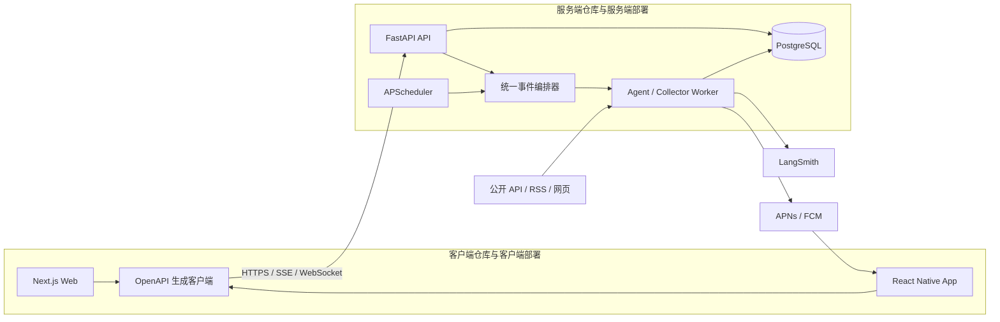
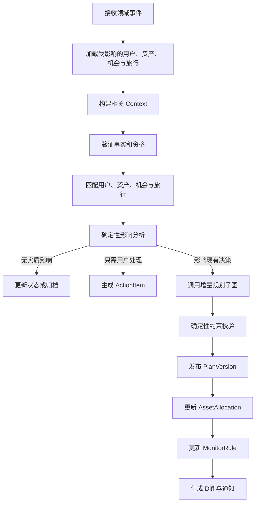
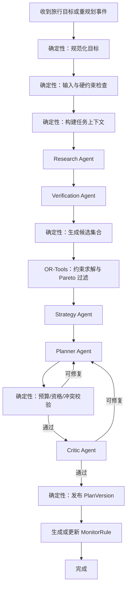
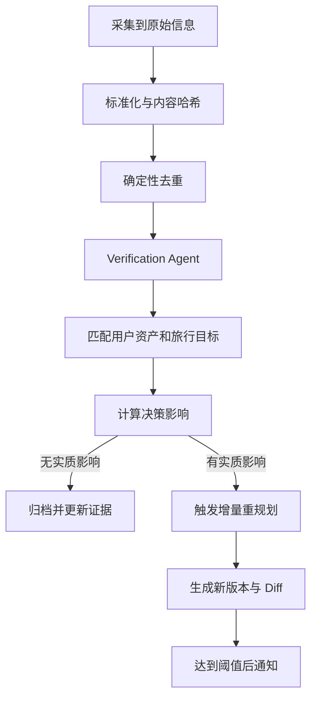

# 常旅客体验优化 Agent 技术基线（规划初始态）

> 文档状态：开工前规划副本，不代表当前项目实现  
> 原始基线日期：2026-08-16  
> 副本整理日期：2026-08-17  
> 对应产品文档：[常旅客体验优化 Agent 产品基线（规划初始态）](../product/product-baseline-initial.md)  
> 实施状态：尚未开始；本文中的组件、接口、数据模型和验收项均为目标设计

## 1. 技术目标

本系统需要实现的不是一次性旅行问答，而是一个长期运行的、有状态的、事件驱动的 Agent 系统。

技术目标包括：

1. 将用户目标、资产、机会、证据和计划作为结构化长期状态保存；
2. 将信息研究、事实验证、策略生成、约束求解和计划表达分阶段编排；
3. 支持定时监控、外部机会事件和用户状态变化；
4. 支持失败恢复、暂停等待、增量重规划和计划版本化；
5. 关键结论具备来源、有效期和置信状态；
6. LLM 不承担精确计算、硬约束校验和数据库直接写入；
7. Web 和移动端共用同一套后端、Agent 和数据；
8. 每次运行可追踪、可复现、可比较和可评测；
9. 项目能够由个人逐步完成，不依赖过度复杂的基础设施。

## 2. 总体技术选型

### 2.1 主方案

```text
开发语言：Python 3.12+
依赖管理：uv

模型调用：可替换的 OpenAI-compatible Provider Adapter；具体供应商和模型通过评测后确定
Agent 编排：LangGraph
结构化数据：Pydantic 2
约束优化：OR-Tools CP-SAT

后端 API：FastAPI
数据库：PostgreSQL
ORM：SQLAlchemy 2
数据库迁移：Alembic
语义检索：pgvector，第二阶段按需启用

定时任务：APScheduler
事件机制：PostgreSQL Domain Events / Transactional Outbox

信息采集：httpx + selectolax + feedparser
动态页面：Playwright，仅作为后备方案

Web：Next.js + TypeScript + Tailwind CSS + shadcn/ui
移动端：React Native + Expo + TypeScript
共享客户端：由 FastAPI OpenAPI 生成 TypeScript API Client

Agent 追踪与评测：LangSmith
代码和规则测试：pytest
端到端测试：Playwright

本地运行：Docker Compose
持续集成：GitHub Actions
```

### 2.2 关键取舍

- 本节技术栈描述目标系统；所有组件均处于规划状态，应按可验证的纵向能力逐步引入；
- 实施顺序由后续开发计划决定，不能把目标架构误写成已完成能力；
- LangGraph 是唯一的核心 Agent 编排层；
- 模型接入通过可替换 Provider Adapter 隔离，供应商、模型、端点和凭证只存在于服务端配置；
- 首版不同时引入 OpenAI Agents SDK、LangChain Agent、Dify 或 Coze；
- LangChain 只在确有必要时作为模型适配器使用，不使用其预制 Agent 作为第二套运行时；
- LLM 负责语义理解、研究策略、证据判断、策略设计和解释；
- 普通程序负责金额、日期、资格、约束、状态转换、发布和通知；
- PostgreSQL 是业务事实源，LangGraph Checkpoint 是运行状态，不相互替代；
- 客户端与服务端使用独立代码仓库和独立部署边界；
- Web 与移动端共享生成的 API Client，但不包含服务端业务判断；
- 客户端只能通过版本化 API 访问服务端，不直接访问模型、数据库、采集器或 LangGraph；
- 首版采用模块化单体和独立 Worker，不拆微服务；
- 首版不使用 Kafka、Kubernetes、Elasticsearch 和独立向量数据库。

## 3. 系统架构



### 3.1 仓库与部署边界

目标产品在 Web/App 阶段使用两个代码仓库：

```text
travel-agent-clients
travel-agent-server
```

客户端仓库包含：

- Next.js Web；
- React Native + Expo App；
- OpenAPI 生成的 TypeScript API Client；
- Web 与 App 共享的类型、格式化工具和设计 Token。

服务端仓库包含：

- FastAPI API；
- LangGraph Agent 编排；
- Agent/Collector Worker；
- APScheduler；
- PostgreSQL 数据模型与迁移；
- OR-Tools 求解器；
- Prompt、评测集与回归测试。

部署时至少包含：

1. `web`：Next.js Web 部署；
2. `api`：FastAPI HTTP API；
3. `worker`：Agent Graph、采集器、事件消费者和定时任务；
4. `postgres`：业务数据、事件、计划版本和 Checkpoint；
5. `mobile`：通过应用商店或测试渠道分发的客户端。

移动端通过 Expo 开发和发布，不需要复制后端服务。


### 3.2 前后端责任边界

客户端负责：

- 展示个人资产、旅行计划、机会情报和行动；
- 收集用户输入；
- 展示运行进度和计划 Diff；
- 保存少量非敏感缓存；
- 使用安全存储保存客户端登录凭证。

客户端不负责：

- 直接调用模型；
- 运行 LangGraph；
- 访问 PostgreSQL；
- 采集外部网站；
- 判断正式资格；
- 执行正式金额、积分和权益分配；
- 保存服务端密钥。

服务端是用户资产、机会、证据、计划和行动的唯一事实源。所有正式业务写入必须在服务端重新验证。

### 3.3 服务端模块化单体

服务端在同一个服务端仓库中按领域拆分模块，但首版不强制拆成多个微服务。

建议领域模块：

```text
identity       用户与认证
traveler       偏好与常旅客资产
trip           旅行目标
source         来源注册与访问策略
evidence       原始事实和证据
opportunity    机会识别、去重和有效性
strategy       长期策略路径
planning       候选方案、优化和计划版本
monitoring     监控规则、调度和通知
orchestration  LangGraph 状态与节点
evaluation     数据集、评测器和实验
```

模块化单体能保持边界清晰，同时降低个人开发的部署和运维负担。

### 3.4 三个产品板块的技术性质

| 产品板块 | 技术性质 | Agent 使用方式 |
|---|---|---|
| 个人旅行资产 | 结构化业务数据和状态维护 | 主要使用普通 CRUD、规则和校验；仅在导入、解释或冲突识别时辅助使用模型 |
| 动态旅行规划 | 核心决策和约束优化 | 使用完整 LangGraph 编排、OR-Tools、校验器和计划版本系统 |
| 常旅客机会情报 | 采集、标准化、验证、匹配和聚合 | 采集与去重主要确定性处理，Verification Agent 负责语义验证，影响分析连接旅行规划 |

行动、监控、通知和计划版本是三个板块共用的横向能力，不构成第四套独立业务系统。

## 4. Agent 编排设计

### 4.1 编排原则

Agent 按推理阶段拆分，不按“机票 Agent、酒店 Agent、信用卡 Agent”简单拆分。

原因是航班、酒店、积分和权益彼此存在强依赖。按产品品类拆分后再让多个 Agent 自由讨论，容易产生：

- 重复研究；
- 上下文膨胀；
- 互相冲突；
- 难以定位错误；
- 无法保证预算和权益不重复使用。

因此建议使用以下逻辑角色：

1. Research Agent；
2. Verification Agent；
3. Strategy Agent；
4. Planner Agent；
5. Critic Agent。

这些角色可以使用同一个模型的不同 Prompt，也可以通过评测后采用不同模型。Agent 角色不等于必须启动五种模型服务。

### 4.2 统一事件编排器

三个产品板块不分别拥有一套顶层 Agent。所有变化先进入统一事件编排器，再决定需要调用哪个子流程。



顶层路由优先由事件类型、对象关系和确定性规则完成。只有事件含义本身存在语义歧义时才调用模型辅助分类。

### 4.3 主规划子图



### 4.4 机会情报子图



### 4.5 事件入口

Graph 不只由聊天请求启动。需要支持以下事件：

```text
TripGoalCreated
TripGoalChanged
TravelerProfileChanged
AssetBalanceChanged
LoyaltyStatusChanged
BenefitAdded
BenefitConsumed
BenefitExpired
OpportunityObserved
OpportunityVerified
OpportunityChanged
OpportunityExpired
EvidenceExpired
RuleChanged
ScheduledReviewDue
PlanInvalidated
PlanPublished
ActionCompleted
UserFeedbackReceived
```

事件路由器根据事件类型选择：

- 完整规划；
- 局部事实更新；
- 增量重规划；
- 只更新监控规则；
- 请求用户补充信息；
- 无影响归档。

### 4.6 强制闭环不变量

编排层必须保证：

1. 每个有效机会最终进入无关、继续监控、需要行动或触发重规划中的一种状态；
2. 每个正式计划使用的积分和权益都生成 `AssetAllocation`；
3. 每个依赖未来变化的计划决策都生成 `MonitorRule`；
4. 每个需要用户完成的步骤都生成 `ActionItem`；
5. 资产变化会查找并检查所有受影响的有效计划；
6. 机会变化或过期会查找依赖该机会的计划；
7. 重规划生成新的 `PlanVersion`，不得覆盖旧版本；
8. 未受影响的决策应在增量重规划中保持不变；
9. 同一领域事件重复到达不得产生重复计划、占用、行动和通知。

## 5. Agent 与确定性模块的职责

### 5.1 Research Agent

输入：

- 明确的研究任务；
- 当前旅行目标；
- 信息缺口；
- 允许访问的来源和工具；
- 调用次数、Token 和时间预算。

输出：

- 候选事实；
- 来源 URL；
- 抓取或观察时间；
- 仍需验证的问题；
- 是否达到停止条件。

限制：

- 不直接发布建议；
- 不修改用户资产；
- 不写入正式计划；
- 不把搜索摘要视作最终证据。

### 5.2 Verification Agent

输入：候选事实、原始页面或结构化数据、来源元数据。

输出：

- 事实主张；
- 适用条件；
- 有效期；
- 用户是否满足资格；
- 来源支持关系；
- 置信状态；
- 冲突信息和人工确认要求。

建议资格状态：

```text
ELIGIBLE
LIKELY_ELIGIBLE
INELIGIBLE
UNKNOWN
NEEDS_USER_CONFIRMATION
```

### 5.3 Strategy Agent

负责生成跨时间的策略依赖图。

每个策略节点包含：

- 行动；
- 前置条件；
- 截止日期；
- 现金成本；
- 积分成本；
- 预期收益；
- 失败风险；
- 后续节点；
- 备用路径；
- 依赖证据。

### 5.4 Planner Agent

负责将已验证事实、求解结果和策略图转换为用户可读规划本。

Planner 不重新发明价格和资格，也不独立修改求解结果。它的主要任务是：

- 组织方案；
- 解释取舍；
- 生成行动时间线；
- 表达不确定性；
- 生成保守、平衡和进取版本；
- 将证据与建议关联。

### 5.5 Critic Agent

只检查预定义问题：

- 是否遗漏重要限制；
- 结论是否由证据支持；
- 是否存在明显更优候选；
- 是否合理表达风险；
- 是否把假设写成事实；
- 用户是否能理解推荐变化。

Critic 无权无限循环。最多两次修复，超过上限则标记需要人工检查。

### 5.6 确定性服务

以下能力必须使用普通程序实现：

- 货币换算；
- 税费和附加费用汇总；
- 积分与里程余额扣减；
- 日期、时区和停留区间计算；
- 预算上限；
- 航班、酒店和活动时间冲突；
- 权益重复使用；
- 资格布尔规则；
- 信息内容哈希和去重；
- 证据过期判断；
- 状态转换；
- 事件幂等；
- 计划版本发布；
- Diff 生成；
- 通知阈值。

Agent 只能提交结构化候选结果，正式持久化由确定性节点完成。

## 6. LangGraph 状态与持久化

### 6.1 Graph State

Graph State 只保存当前运行需要的工作状态，例如：

```python
class PlanningState(BaseModel):
    run_id: UUID
    event_id: UUID
    traveler_id: UUID
    trip_goal_id: UUID
    context_pack: ContextPack
    research_tasks: list[ResearchTask]
    candidate_evidence_ids: list[UUID]
    verified_evidence_ids: list[UUID]
    candidate_option_ids: list[UUID]
    solver_result: SolverResult | None
    strategy_draft: StrategyDraft | None
    plan_draft: PlanDraft | None
    validation_issues: list[ValidationIssue]
    repair_count: int
    status: RunStatus
```

Graph State 不保存完整用户数据库副本，也不把所有历史聊天塞入状态。

### 6.2 Checkpoint 与业务数据库

两类持久化用途不同：

| 类型 | 用途 |
|---|---|
| LangGraph Checkpoint | 保存一次运行执行到哪一步，支持失败恢复、暂停和继续 |
| 业务表 | 保存用户、资产、证据、机会、策略、计划和监控规则 |

推荐使用 PostgreSQL Checkpointer。每次运行使用稳定的 `thread_id` 或等价运行标识。

### 6.3 暂停与人工确认

以下情况应中断 Graph 并等待用户：

- 缺少会显著改变方案的关键偏好；
- 资格依赖用户未提供的信息；
- 多个方案差异主要来自主观取舍；
- 高风险特殊低价需要用户明确接受不确定性；
- 系统发现用户数据互相矛盾。

恢复时从 Checkpoint 继续，不重复已完成的采集和计算。

### 6.4 循环与重试上限

建议初始限制：

```text
Research 补充检索：最多 2 轮
Verification 冲突复查：最多 1 轮
Planner 修复：最多 2 轮
Critic 复查：最多 2 轮
网络瞬时失败：指数退避，最多 3 次
```

所有外部调用必须设置超时、重试策略和全局运行预算。

## 7. 数据模型

### 7.1 核心实体

#### TravelerProfile

- 常用出发城市与机场；
- 语言、货币和时区；
- 舱位、酒店、转机和行李偏好；
- 风险偏好；
- 执行复杂度容忍度；
- 用户自定义积分价值。

#### LoyaltyAccount

- 计划类型：航空或酒店；
- 会员体系；
- 会籍等级；
- 会员号脱敏标识；
- 积分或里程余额；
- 余额更新时间；
- 会籍有效期；
- 数据来源：用户确认或系统推断。

不保存账户密码。

#### BenefitAsset

- 权益类型；
- 所属信用卡、会籍或票券；
- 数量和剩余次数；
- 有效期；
- 地区和产品限制；
- 估值和估值依据。

#### TripGoal

- 目的地；
- 出发地和备选机场；
- 日期范围；
- 预算；
- 同行人；
- 硬约束；
- 软偏好；
- 当前状态。

#### Source

- 稳定 `source_id`、主体、来源名称和 URL；
- 来源类型、角色和可信等级；
- 访问类别、权限状态和自动化模式；
- 地区、语言和生命周期；
- Robots/条款检查状态和允许访问频率；
- 任务状态与是否允许进入当前采集 allowlist；
- 配置版本和最后人工复核时间。

当前审计注册表是 `Source` 的导入种子，不是运行时数据库。重复导入按稳定 ID upsert，未列入当前 allowlist 的来源保持禁用。

#### SourceObservation

表示“在某个时间对某来源做了一次具体观察”，成功和失败均保存：

- 来源、观察时间、请求 URL 和最终 URL；
- HTTP 状态、检索模式、成功/未变/失败状态和错误原因；
- 原始内容位置与哈希；
- 规范化内容哈希和内容版本；
- Fetcher、解析器版本和耗时。

同一来源的新观察不会覆盖旧观察；内容未变也保留 check 记录，但不生成重复业务版本。

#### EvidenceClaim

- 一个可独立核验的主语、谓词和值；
- 支持它的具体 `SourceObservation`；
- 原文片段、字符位置或结构化字段路径；
- 事实生效和失效时间；
- 验证状态；
- 置信度；
- 抽取器和 Schema 版本。

原始页面属于 `SourceObservation`，不是 claim。页面未提供的字段保持 `UNKNOWN` 或不生成 claim，不能由模型补成已验证事实。

#### Opportunity

- 机会类型；
- 标题和摘要；
- 资格条件；
- 时间窗口；
- 现金和积分成本；
- 预期价值；
- 风险等级；
- 当前生命周期和当前版本；
- 关联的 EvidenceClaim；
- 去重键；
- 首次和最后观察时间。

模型只生成 `OpportunityCandidate`。确定性发布器校验 Schema、日期、生命周期、证据支持、访问边界和去重后，才创建或更新正式 `Opportunity`。

#### OpportunityVersion

- 机会的资格、地区、目标等级、挑战要求、费用和时间窗口；
- `ACTIVE / UPCOMING / AWAIT / EXPIRED / UNKNOWN` 生命周期；
- 前一版本、Schema 版本和发布器版本；
- 发布决定、风险和人工确认项；
- 支持各字段的 EvidenceClaim 连接。

正式版本不可原地覆盖。规则变化创建新版本，并保留旧规则和相应观察。

#### ExtractionRun

- 输入的 Observation；
- 模型、Prompt、Schema 和代码版本；
- 原始结构化候选输出；
- Token、成本和延迟；
- 确定性校验错误与发布决定；
- 保证重复处理无副作用的幂等键。

#### OpportunityMatch

连接机会情报、个人旅行资产和旅行目标：

- 用户；
- 机会；
- 可选的关联旅行目标；
- 资格状态；
- 相关性分数；
- 预计现金、积分和体验影响；
- 缺失信息；
- 推荐动作；
- 是否达到重规划阈值；
- 匹配和重新验证时间。

#### StrategyNode

- 行动；
- 前置节点；
- 截止时间；
- 成本；
- 收益；
- 风险；
- 状态；
- 备用节点。

#### PlanDecision

记录计划中一项可追溯的正式决策：

- 所属 PlanVersion；
- 决策类型和对象；
- 选择结果；
- 被放弃的主要备选；
- 依赖的用户偏好；
- 依赖的资产、机会和证据；
- 成本、价值和风险贡献；
- 失效条件；
- 备用决策。

#### AssetAllocation

连接个人旅行资产与旅行方案，防止同一资产重复使用：

- 资产；
- 旅行目标和计划版本；
- 方案类型；
- 预留或已使用数量；
- 状态；
- 生效和释放时间；
- 来源决策。

建议状态：

```text
PROPOSED
RESERVED
CONFIRMED_USED
RELEASED
EXPIRED
```

#### ActionItem

连接资产、机会、策略和计划，为 Web 与 App 提供统一行动中心：

- 用户；
- 行动类型和说明；
- 来源对象；
- 关联旅行；
- 截止时间；
- 优先级；
- 完成条件；
- 状态；
- 完成后需要产生的领域事件。

#### PlanVersion

- 旅行目标；
- 版本号；
- 基于哪些事实和机会生成；
- 三类方案；
- 当前推荐；
- 成本和价值分解；
- 行动清单；
- 风险和备选方案；
- 相对上一版本的 Diff；
- Prompt、模型和代码版本；
- 发布时间。

PlanVersion 本身保持不可变。资产占用、正式决策、行动和监控通过关联实体保存，不把整个闭环压缩进一段计划文本。

#### MonitorRule

- 监控对象；
- 频率；
- 查询参数；
- 触发阈值；
- 下次执行时间；
- 失效条件；
- 关联旅行目标。

#### DomainEvent

- 事件类型；
- 聚合对象；
- Payload；
- 幂等键；
- 创建、处理和失败时间；
- 重试次数；
- 处理状态。

#### AgentRun

- 输入事件；
- Graph 版本；
- Prompt 版本；
- 模型配置；
- 节点轨迹；
- Token、延迟和费用；
- 输出；
- 错误；
- 评测结果。

### 7.2 事实来源状态

所有进入上下文的信息应标记来源类别：

```text
USER_CONFIRMED
EXTERNAL_VERIFIED
EXTERNAL_UNVERIFIED
MODEL_INFERRED
STALE
CONFLICTING
```

正式计划中的关键结论只能直接依赖：

- `USER_CONFIRMED`；
- `EXTERNAL_VERIFIED`；
- 明确标注不确定性的其他状态。

## 8. Context 工程

### 8.1 Context Builder

每个 Agent 不直接查询所有数据库表，而是由 Context Builder 生成任务专属上下文包。

一个 Context Pack 包含：

```text
任务目标
允许的决策范围
硬约束
相关用户偏好
相关资产
相关旅行目标
相关机会
已验证证据
上一计划的决策摘要
信息缺口
可用工具
输出 Schema
调用与停止预算
```

### 8.2 上下文路由

示例：

- Research Agent 不需要完整历史计划文案；
- Verification Agent 不需要用户所有无关信用卡；
- Strategy Agent 只接收已验证机会和相关资产；
- Planner 接收求解结果，不接收全部原始网页；
- Critic 接收计划、关键证据和约束，不重新进行广泛搜索。

### 8.3 长期记忆

长期记忆由结构化数据库实现：

- 稳定偏好；
- 用户确认的资产；
- 历史机会；
- 历史计划决策；
- 用户反馈；
- 失败策略和放弃原因。

对历史文本进行语义检索只是辅助，不作为事实真相。

### 8.4 Prompt 版本管理

Prompt 保存在代码仓库：

```text
prompts/
  research/v1.jinja2
  verification/v1.jinja2
  strategy/v1.jinja2
  planner/v1.jinja2
  critic/v1.jinja2
```

每次运行记录：

```text
prompt_name
prompt_version
schema_version
model_provider
model
inference_mode
context_item_ids
context_tokens
tool_permissions
```

Prompt 中应明确：

- 目标和成功标准；
- 允许做什么；
- 禁止做什么；
- 证据要求；
- 输出 Schema；
- 工具权限；
- 重试和停止条件；
- 不确定性表达方式。

## 9. 模型与工具调用

### 9.1 模型接入

模型通过服务端统一的 Provider Adapter 接入。供应商、模型、凭证、端点和推理参数由环境配置
与版本化运行配置提供，不在业务请求中硬编码。所有模型输出先经过本地 Pydantic Schema 与
确定性业务校验，模型不能直接写入正式业务对象。

在选定具体供应商和模型前，应使用同一评测集比较质量、延迟、成本、结构化输出稳定性和数据
合规条件；选型结果只有在评测和风险复核后才能升级为实施契约。

首版策略：

1. 先用同一种平衡型模型跑所有推理节点，建立质量和成本基线；
2. 评测稳定后，将抽取、分类和去重路由到低成本模型；
3. 将复杂资格判断、策略生成和 Critic 保留给更强模型；
4. 最高成本模型只用于评测证明有明显收益的高价值场景。

### 9.2 工具权限

不同 Agent 使用不同工具白名单。

| Agent | 允许工具 |
|---|---|
| Research | 搜索、来源目录、公开页面读取、机会数据库查询 |
| Verification | 原始证据读取、规则查询、时间和资格辅助工具 |
| Strategy | 已验证证据查询、资产查询、策略规则、候选结果读取 |
| Planner | 求解结果、计划模板、证据引用查询 |
| Critic | 只读计划、约束、证据和验证报告 |

所有 Agent 均不得直接执行 SQL 写入、发送通知或修改正式计划。

### 9.3 结构化输出

所有节点使用 Pydantic Schema 验证输出。

验证分两层：

1. 结构验证：字段、类型、枚举、必填项；
2. 语义验证：预算、资格、引用支持、状态转换和业务不变量。

结构合法不代表业务正确，因此不能只依赖 JSON Schema。

## 10. 约束求解与推荐

### 10.1 求解器职责

OR-Tools CP-SAT 用于：

- 从候选航班、酒店和权益中选择组合；
- 保证预算、日期、余额和资格约束；
- 防止同一权益重复使用；
- 生成多个具有不同偏好的可行方案；
- 在大量候选中进行 Pareto 或加权目标优化。

### 10.2 变量示例

```text
x_flight_i       是否选择航班候选 i
x_hotel_j        是否选择酒店候选 j
x_benefit_k      是否使用权益 k
x_strategy_m     是否采用策略节点 m
```

### 10.3 硬约束示例

```text
总现金成本 <= 用户预算
每个旅行日期必须有住宿覆盖
航班到达时间必须早于酒店入住或后续交通
积分使用量 <= 可用积分余额
每张权益券使用次数 <= 剩余次数
不满足资格的机会不得选择
互斥方案不得同时选择
```

### 10.4 软目标示例

```text
maximize (
  flight_experience
  + hotel_experience
  + lounge_and_breakfast_value
  + points_redemption_value
  + future_strategy_value
  + convenience
  - cash_cost
  - execution_complexity
  - uncertainty_risk
)
```

权重来自用户偏好和产品默认值，并在结果中展示主要贡献因素。

### 10.5 多方案输出

求解器至少生成：

- 保守：高确定性、低执行复杂度；
- 平衡：成本、体验和风险综合最优；
- 进取：允许等待库存或参与挑战，潜在价值更高。

LLM 负责解释三者差异，不负责凭空修改求解结果。

## 11. 信息采集系统

### 11.1 适配器分层

```text
API Adapter
RSS/Feed Adapter
Static HTML Adapter
Dynamic Browser Adapter
Manual Import Adapter
```

优先使用结构化来源，Playwright 仅用于允许访问但必须执行 JavaScript 的公开页面。

### 11.2 采集流水线

```text
Fetch
→ 写入成功或失败 SourceObservation
→ Normalize / Hash / Version
→ 若内容未变则停止业务处理
→ Extract EvidenceClaim + OpportunityCandidate
→ Deterministic Validate
→ Publish OpportunityVersion 或记录拒绝
→ 后续阶段再 Match / Materiality Check / Emit Event
```

抽取和正式发布是两个不同权限层。LLM 不能直接写正式 `Opportunity`；失败访问、无支持字段、无效日期和重复事件不得污染正式表。

### 11.3 来源注册表

每个来源保存：

- 稳定来源 ID、主体、角色和可信等级；
- 访问类别、权限状态、自动化模式和只读范围；
- 访问频率；
- 解析器版本；
- 是否需要动态渲染；
- 条款和 Robots 检查结果；
- 最后成功和失败时间；
- 连续失败次数；
- 熔断状态。

### 11.4 去重

组合使用：

- 规范化 URL；
- 内容哈希；
- 受治理活动 ID、来源内 item ID 或 canonical item identity，经版本化确定性 resolver 生成的
  source-scoped 正式业务键；
- 标题、日期、资格、等级、挑战阈值和费用组成的规则相似度或版本指纹，但这些可变字段不得进入
  稳定正式业务键；
- 第二阶段可加入向量相似度。

模型建议的 `business_key` 只保留在原始抽取输出中供审计，不能用于查询、创建或合并正式
Opportunity。identity basis 不唯一时必须拒绝正式发布并进入人工复核，不能回退到标题模糊匹配。
identity basis 与 resolver 版本在 observation 创建时冻结；Publisher 和最终 Repository 都只接受
由该快照确定性生成的 formal identity，不能从后续变化的 Source 配置或模型候选重新取键。

规则指纹只用于比较锁定后的当前 Version，不做全历史唯一约束。相同历史状态再次出现时仍形成
新的时间版本；乱序旧 observation 不能回退 current state 或 `last_observed_at`。产生或复用正式
版本的 extraction run 在同一事务中绑定精确 Opportunity/Version/created_version，重放只读绑定。

### 11.5 证据快照

关键证据建议保存：

- 原始响应或允许保存的正文；
- 抓取时间；
- HTTP 状态和响应头；
- 内容哈希；
- 解析器版本；
- 提取字段；
- 受治理 identity basis 与 resolver 版本；
- 对应来源 URL。

如果来源条款不允许保存全文，则只保存必要字段、哈希、摘要和链接。

快照与 claim 必须分离：快照说明“当时页面是什么”，claim 说明“系统从该版本中支持了哪个具体事实”。正式机会字段必须通过连接表指向对应 claim。

### 11.6 调度频率

频率由信息时效与成本决定：

```text
高价值库存或价格：15～60 分钟
重点活动页：1～6 小时
普通促销源：每日
规则与会籍说明：每周或按变更检测
临近截止的机会：自动提高频率
```

## 12. 事件、任务与幂等

### 12.1 PostgreSQL Outbox

业务写入和事件创建放在同一数据库事务中，避免业务状态已经改变但事件丢失。

Worker 使用事件状态和幂等键消费：

```text
PENDING
PROCESSING
SUCCEEDED
FAILED_RETRYABLE
FAILED_FINAL
```

### 12.2 幂等键示例

```text
source_id + external_item_id + observed_version
trip_goal_id + triggering_event_id + graph_version
user_id + notification_type + plan_version
```

### 12.3 调度器职责

APScheduler 只负责到点创建任务或事件。长期业务状态仍保存在 PostgreSQL，不依赖进程内存。

首版可以让一个 Worker 同时承担：

- 处理调度；
- 消费领域事件；
- 运行 Agent Graph；
- 执行采集任务。

任务量增长后再拆独立队列或使用 Temporal/Celery，不在首版提前引入。

## 13. 后端 API

### 13.1 API 原则

- 客户端不直接调用模型；
- 客户端不直接访问数据库、采集器和 LangGraph 内部状态；
- Agent API 使用异步运行模式；
- 创建任务后立即返回 `run_id`；
- Web 和 App 使用相同 API；
- 写操作需要认证、权限检查和幂等键；
- 所有正式业务判断由服务端执行，客户端计算只用于展示预览；
- 公开接口从 `/v1` 开始版本化；
- 浏览器跨域访问使用明确的 CORS 来源白名单；
- 正式计划与运行草稿使用不同接口。

### 13.2 OpenAPI 契约

FastAPI 根据 Pydantic Schema 生成 `openapi.json`。客户端仓库通过 CI 或开发脚本生成 TypeScript API Client，避免 Web、App 和服务端分别手写重复类型。

接口变更流程：

```text
服务端修改 Pydantic Schema
→ 更新并校验 openapi.json
→ 客户端重新生成 api-client
→ TypeScript 编译发现不兼容调用
→ 完成客户端适配后发布
```

LangGraph 的内部 `State`、节点名称和原始 Trace 不作为公开 API 契约。API 只暴露稳定的运行状态、计划、机会、行动和进度事件 Schema。

### 13.3 核心接口示例

```text
POST   /v1/traveler-profiles
GET    /v1/traveler-profiles/{id}
PATCH  /v1/traveler-profiles/{id}

POST   /v1/loyalty-accounts
PATCH  /v1/loyalty-accounts/{id}
POST   /v1/benefit-assets
GET    /v1/benefit-assets/{id}/allocations

POST   /v1/trips
GET    /v1/trips/{id}
PATCH  /v1/trips/{id}

POST   /v1/trips/{id}/plan-runs
GET    /v1/runs/{run_id}
GET    /v1/runs/{run_id}/events

GET    /v1/trips/{id}/plans
GET    /v1/trips/{id}/plans/latest
GET    /v1/plans/{version_id}/diff

GET    /v1/opportunities
GET    /v1/opportunities/{id}
GET    /v1/opportunities/{id}/matches
POST   /v1/opportunities/{id}/follow
POST   /v1/opportunities/{id}/link-trip
POST   /v1/opportunities/{id}/feedback

GET    /v1/actions
PATCH  /v1/actions/{id}
POST   /v1/actions/{id}/complete

GET    /v1/monitor-rules
PATCH  /v1/monitor-rules/{id}
```

### 13.4 长任务交互

```text
客户端 POST 创建规划运行
→ API 返回 run_id
→ Worker 异步执行 Graph
→ Graph 每个节点更新运行状态
→ Web 使用 SSE 获取进度
→ App 使用轮询或 WebSocket 获取进度
→ 完成后读取最新 PlanVersion
→ 必要时发送推送通知
```

客户端关闭不影响后端继续运行。

## 14. Web 与移动端

### 14.1 Web

技术栈：

```text
Next.js App Router
TypeScript
Tailwind CSS
shadcn/ui
TanStack Query
```

主要页面：

- 旅行目标；
- 常旅客资产；
- 旅行规划本；
- 方案比较；
- 行动时间线；
- 机会中心；
- 监控中心；
- 证据详情；
- 计划版本 Diff；
- 开发者模式下的 Agent Trace 摘要。

### 14.2 移动端

技术栈：

```text
React Native
Expo
Expo Router
TypeScript
Expo SecureStore
Expo Notifications
```

主要页面：

- 当前旅行；
- 今日与近期行动；
- 重要机会；
- 计划变化；
- 旅行中权益速查；
- 快速资产更新；
- 通知设置。

### 14.3 共享代码

Web 与移动端保存在独立的客户端仓库中，并在该仓库内使用 Monorepo：

```text
travel-agent-clients/
  apps/
    web/
    mobile/

  packages/
    api-client/
    types/
    domain-utils/
    design-tokens/
```

共享：

- OpenAPI 生成客户端；
- TypeScript 类型；
- 金额、积分和日期格式化；
- 登录状态；
- 埋点事件；
- 设计 Token。

`api-client` 由服务端 OpenAPI Schema 自动生成。客户端不复制服务端的资格判断、约束求解、资产分配和计划发布逻辑，也不强行共享所有 Web 与移动端 UI 组件。

### 14.4 推送通知

移动端通过 Expo Notifications，底层使用 APNs 和 FCM。

通知服务只发送摘要和深链，不在通知正文暴露敏感资产信息。

## 15. 可观测性

### 15.1 Agent Trace

LangSmith 记录：

- 一次运行的完整节点路径；
- 每个节点输入输出；
- 模型和 Prompt 版本；
- 工具调用；
- Token、费用和延迟；
- 重试与错误；
- 最终计划版本；
- 人工反馈和评测分数。

### 15.2 应用监控

应用侧至少记录：

- API 请求成功率和延迟；
- Worker 队列长度；
- 事件积压；
- 采集成功率；
- 来源连续失败；
- Graph 节点失败率；
- 平均规划时间；
- Token 和模型费用；
- 通知数量与点击率；
- 计划更新频率。

### 15.3 隐私处理

发送到追踪平台前应脱敏：

- 会员号；
- 邮箱和手机号；
- 身份信息；
- 订单信息；
- 任何访问凭证。

生产环境应允许按用户关闭详细内容追踪。

## 16. Agent 评测体系

### 16.1 评测数据集

首个离线评测集建议包含：

- 30～40 个静态案例；
- 8～10 个跨时间变化案例；
- 若干工具失败和来源冲突案例；
- 若干恶意或越界输入案例；
- 对关键事实、资格判断、计划约束和证据引用建立人工金标。

案例覆盖：

- 预算不足；
- 积分余额不足；
- 权益重复使用；
- 定向活动资格未知；
- 规则过期；
- 多来源冲突；
- 新机会只影响局部计划；
- 机会看似便宜但执行风险过高；
- 用户偏好改变；
- 同一事件重复到达。

### 16.2 四层评测

#### 第一层：确定性规则

- Schema 合法性；
- 预算；
- 日期；
- 资格；
- 余额；
- 重复权益；
- 引用完整性；
- 幂等。

#### 第二层：Agent 节点

- 信息提取准确率；
- 资格判断准确率；
- 证据支持率；
- 工具选择；
- 不确定性识别；
- 输出完整性。

#### 第三层：编排轨迹

- 是否进入正确节点；
- 是否发生无意义循环；
- 是否在缺信息时暂停；
- 是否在失败后恢复；
- 是否只重算受影响部分；
- 是否遵守调用预算。

#### 第四层：端到端产品质量

- 用户目标满足程度；
- 硬约束错误；
- 方案体验与成本；
- 可解释性；
- 行动可执行性；
- 证据质量；
- 延迟和成本。

### 16.3 基线与消融实验

至少比较：

1. 无工具的单 Prompt；
2. 单 Agent + 工具 + 全量上下文；
3. 多阶段编排 + 选择性 Context；
4. 多阶段编排 + 确定性求解和校验。

多 Agent 结构只有在满足以下任一条件时才保留：

- 总体质量提高至少 8 个百分点；
- 严重错误下降至少 30%；

同时运行成本不超过单 Agent 基线的 2 倍。否则应合并节点。

Context Router 的目标：

- 上下文 Token 减少至少 30%；
- 总体质量下降不超过 2 个百分点。

### 16.4 目标指标

```text
硬约束违反拦截率：100%
权益重复使用拦截率：100%
关键资格判断准确率：>= 90%
关键结论引用覆盖率：100%
引用支持率：>= 95%
机会抽取 Precision：>= 90%
机会抽取 Recall：>= 80%
重复机会率：<= 5%
应重规划事件触发率：>= 95%
未受影响决策保留率：>= 95%
事件幂等率：100%
```

### 16.5 CI 回归

GitHub Actions 每次合并运行：

- 单元测试；
- Schema 测试；
- 数据库迁移测试；
- 小型冻结评测集；
- Prompt 输出格式回归；
- 关键业务不变量测试。

完整模型评测可以每日或手工运行，避免每次提交产生过高费用。

## 17. 安全、隐私与合规

### 17.1 产品能力边界

后端工具层不实现以下写操作：

- 预订；
- 支付；
- 取消；
- 转点；
- 买分；
- 会籍匹配提交；
- 信用卡申请。

从技术权限上移除这些能力，而不只依赖 Prompt 禁止。

### 17.2 凭证管理

- 模型、数据库和第三方服务密钥仅保存在服务端；
- 本地使用 `.env`，不提交 Git；
- 生产使用托管 Secret；
- App 只保存短期访问 Token；
- 不保存常旅客账户密码；
- 日志和 Trace 禁止记录密钥。

### 17.3 采集合规

- 来源白名单；
- 访问频率限制；
- 尊重 Robots 和使用条款；
- 不绕过验证码；
- 不绕过登录和访问控制；
- 可按来源立即停用；
- 保留抓取时间和来源；
- 对疑似错误价格明确提示履约风险。

### 17.4 用户数据

- 收集最少必要信息；
- 会员号默认脱敏；
- 支持删除账户和关联数据；
- 计划导出不包含内部 Trace；
- 明确区分用户输入、外部事实和模型推断。

## 18. 建议代码结构

### 18.1 客户端仓库

```text
travel-agent-clients/
  apps/
    web/
    mobile/

  packages/
    api-client/
    types/
    domain-utils/
    design-tokens/

  tests/
    web-e2e/
    mobile-e2e/
```

### 18.2 服务端仓库

```text
travel-agent-server/
  apps/
    api/
    worker/

  src/
    common/
      config/
      db/
      events/
      observability/
    identity/
    traveler/
    trip/
    source/
    evidence/
    opportunity/
      matching/
    strategy/
    planning/
      solver/
      validators/
      publisher/
      diff/
    action/
    monitoring/
    orchestration/
      graphs/
        event_orchestrator/
        planning/
        opportunity/
      nodes/
      state/
      tools/
      context/
    evaluation/

  prompts/
    research/
    verification/
    strategy/
    planner/
    critic/

  migrations/
  tests/
    unit/
    integration/
    contract/
    evals/

  infra/
    docker/
    compose/
    github-actions/
```

### 18.3 跨仓库契约

服务端仓库在 CI 中生成和校验 `openapi.json`。客户端仓库基于该文件生成 `packages/api-client`。可以使用固定版本的 Schema 文件、构建产物或独立包传递契约，但不通过复制后端 Python 模型共享代码。

目录可以随实现调整，但以下边界应保留：

- 客户端与服务端不互相导入源代码；
- 客户端只依赖公开 API 契约；
- Domain 与 Agent Prompt 分开；
- Agent 节点与确定性验证器分开；
- 原始证据与正式机会分开；
- 草稿与正式计划版本分开；
- 业务数据与评测数据分开。

## 19. 开发阶段

### 阶段 0：单 Agent 与最小事实底座

实现：

- TravelerProfile、资产、TripGoal 和手工候选行程；
- 少量人工审核的公开机会及其来源、观察时间和证据；
- 单 Agent + 工具的结构化规划；
- 预算、日期、资格和权益占用验证器；
- 不依赖 Graph 的 PlanVersion 发布；
- 旅行规划离线评测基线。

完成标准：

- 能从结构化资产、目标和已验证机会生成三类规划本；
- 计划有证据、约束校验和不可变版本；
- 能测出单 Agent 的主要错误类型和基准成本；
- 能根据评测结果决定后续是否拆分 Agent、自动采集或引入求解器。

### 阶段 1：核心规划 Graph 与编排评测

实现：

- LangGraph 状态与 PostgreSQL Checkpoint；
- Research、Verification、Strategy、Planner、Critic 候选节点；
- 结构化 Context Builder、工具权限和循环预算；
- 暂停、恢复和人工确认；
- 单 Agent 与多阶段编排消融实验。

完成标准：

- Graph 可恢复、可追踪且所有循环有上限；
- 编排相对单 Agent 基线达到预设质量或严重错误收益；
- 不能证明收益的节点被合并或删除。

### 阶段 2：持续采集与增量重规划

实现：

- APScheduler 和 Domain Events / Outbox；
- StatusMatch/GetStatus 邮箱、重点地区矩阵和新 URL 发现适配器；
- 机会匹配、过期、重要性判断和监控升级；
- `AssetAllocation`、`PlanDecision`、`ActionItem`；
- 增量重规划、计划 Diff 和通知。

完成标准：

- 新机会能自动进入验证、匹配和影响判断；
- 无影响事件不触发完整重算；
- 同一事件重复到达没有重复副作用。

### 阶段 3：约束优化、Web 与移动端

实现：

- OR-Tools 候选组合和三种风险等级方案；
- 模型路由、成本和延迟报表；
- Next.js Web 与 OpenAPI Client；
- Expo App；
- 登录和安全存储；
- 当前计划与行动；
- 机会与计划变化；
- 推送通知；
- 离线缓存关键旅行信息。

完成标准：

- App 与 Web 读取同一数据；
- 关闭 App 不影响 Agent 运行；
- 推送可深链到具体计划变化或机会。

## 20. 技术验收标准

### 20.1 编排

- Graph 节点和状态转换可视化；
- 三个产品板块的事件均先进入统一事件编排器；
- 每个 Agent 有独立 Prompt、工具权限和输出 Schema；
- 所有循环有明确上限；
- 运行中断后可以从 Checkpoint 恢复；
- 外部事件可以触发增量重规划；
- 未受影响的状态不会被无意义重写。

### 20.2 数据

- 用户状态、证据、机会和计划结构化保存；
- OpportunityMatch、AssetAllocation、PlanDecision 和 ActionItem 具备可查询关联；
- 关键事实包含来源和时间；
- 计划版本不可被原地覆盖；
- 数据库迁移可从空库成功执行；
- 同一业务事件可以安全重放。

### 20.3 约束与正确性

- 硬约束由确定性代码校验；
- 金额和积分使用可重算；
- 权益不会被重复分配；
- 过期和未验证信息不会静默进入正式结论；
- LLM 输出失败不会污染正式数据。

### 20.4 评测

- 具备冻结案例和时间线案例；
- 能比较单 Agent 与编排系统；
- 能比较不同 Prompt、Context 和模型；
- 每次实验记录质量、Token、成本和延迟；
- CI 能阻止关键指标回退。

### 20.5 前后端分离与双端

- 客户端与服务端使用独立仓库和独立部署边界；
- Web 和 App 使用统一身份和 API；
- API 类型由 OpenAPI 同步；
- 客户端无法直接访问模型、数据库和 LangGraph；
- 服务端对所有正式业务写入重新验证；
- API 契约测试能够发现破坏性变更；
- Agent 任务在服务端异步执行；
- Web 能显示完整规划与 Diff；
- App 能显示行动、机会、计划变化并接收推送。

## 21. 明确不在首版引入

```text
Dify / Coze 作为核心运行时
OpenAI Agents SDK 与 LangGraph 双重编排
LangChain 预制 Agent 再嵌套 LangGraph
Kafka
Kubernetes
Elasticsearch
独立向量数据库
多区域部署
复杂微服务治理
自动交易与账户操作
登录态网页采集
```

如果未来某个组件出现明确瓶颈，再通过评测、负载数据或运维需求决定是否引入替代方案。

## 22. 推荐的技术证明材料

为了在简历和面试中真实体现能力，项目最终应公开或演示以下材料：

1. Agent Graph 和状态转换图；
2. 统一事件编排器连接三个产品板块的完整链路；
3. 一次完整规划 Trace；
4. 外部机会触发增量重规划并更新资产、行动和监控的时间线；
5. 单 Agent 与多阶段编排的对比评测；
6. Context 路由前后的 Token 与质量对比；
7. Critic 和确定性校验分别拦截的错误案例；
8. 计划版本 Diff；
9. 模型质量、延迟和成本路由结果；
10. 前后端独立部署且 Web 与 App 共用同一 API 的实际演示；
11. 真实用户测试结果和已知限制。

这些材料比“使用了多少个 Agent”更能证明 Agent 编排、评测与 Prompt/Context 工程能力。

## 23. 官方技术参考

- LangGraph：https://docs.langchain.com/oss/python/langgraph/overview
- LangGraph Persistence：https://docs.langchain.com/oss/python/langgraph/persistence
- FastAPI：https://fastapi.tiangolo.com/
- Pydantic：https://docs.pydantic.dev/
- PostgreSQL：https://www.postgresql.org/docs/
- pgvector：https://github.com/pgvector/pgvector
- APScheduler：https://apscheduler.readthedocs.io/
- OR-Tools：https://developers.google.com/optimization
- LangSmith Evaluation：https://docs.langchain.com/langsmith/evaluation
- Next.js：https://nextjs.org/docs/app
- Expo：https://docs.expo.dev/
- Playwright：https://playwright.dev/
