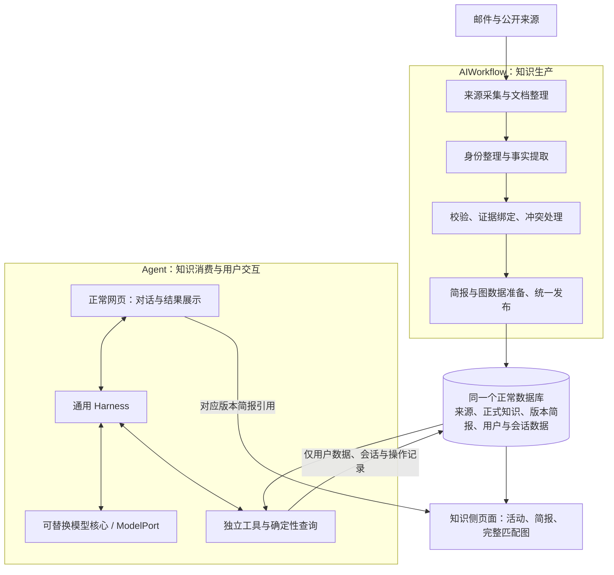

# JourneyPlus 目标架构与模块职责

状态：第一步——目标定义，尚未实施或验收。日期：2026-09-09。
分支：`codex/clean-system-architecture`。

本文件依据用户最新方针定义后续重建目标。本文件现存于新 change `rebuild-clean-workflow-agent-system`，是目标架构的核心正文；旧 OpenSpec change、设计和审计保留为历史参考，不自动成为本轮实施要求。后续先对照本文件审计，再列具体实现及删除清单，不能把本文目标写成当前已经实现的事实。

## 1. 唯一总体方针

**Agent 和 AIWorkflow 是两个大板块，中间共用一个数据库联通。AIWorkflow 负责生产并储存数据，其附属产物是简报和完整匹配图；Agent 负责消费数据，并允许引用对应简报。**

两个板块职责独立，可分别运行、测试和修改。可以由同一个产品进程装配，也可以独立启动；不因此增加微服务、消息队列或第二套业务数据库。数据库是共享数据边界，不是共享任意内部状态的理由。

数据库中的原始资料、处理中间记录、正式知识和用户记忆有不同用途，可以合理分层；“干净”不等于全部压进一张表。禁止为了兼容旧实现而长期维护两套含义相同的权威业务事实。

## 2. AIWorkflow：生产职责

| 模块 | 输入与输出 | 必须承担的职责 | 边界 |
|---|---|---|---|
| 来源管理与采集 | 邮件/订阅/官方页面 → 来源项、原始文档快照 | 读取邮件发现活动；获取官方资料与文章；去重、抓取状态和时间记录 | 不删除源邮箱邮件；不接收 Agent 的隐式采集任务 |
| 文档整理 | 原始快照 → 规范正文、章节和来源标识 | 保留原文、发布时间/抓取时间及精度，保证证据可以定位 | 规范化不擅自改变事实，不把网页指令当系统指令 |
| 身份整理与提取 | 来源章节 → 活动、项目/等级、方案及事实草稿 | 区分不同活动期次，提取映射、费用、条件和时间 | 不靠先生产一套已被替代的旧业务事实才能再生产正式知识 |
| 知识校验 | 草稿＋来源 → 可发布结果或明确待处理原因 | 检查身份关联、证据、费用/条件适用范围、未知项和冲突 | 未知不等于免费或不存在；失败不污染当前发布版本 |
| 简报与图数据 | 同一份已校验事实 → 版本简报及确定性图数据 | 简报表达与证据一致；完整图使用相同版本的映射和条件 | 简报和图不是第二套独立事实来源，不重新猜费用/资格 |
| 统一发布 | 已校验数据及必要产物 → 可消费版本 | 短事务发布，记录来源与版本；切换当前版本前满足发布条件 | 无半套数据冒充就绪；发布期间不持有数据库事务等待模型/网络 |
| 调度与维护 | 显式任务 → 采集/处理/发布状态 | 增量更新、失败重试、幂等与资源控制；明确维护命令 | 与 Agent 的对话执行循环、模型配置分开 |

### 生产过程

来源读取 → 文档规范化 → 必要的身份/事实整理 → 事实校验 → 简报/图数据校验 → 发布正式版本。

必要的阶段化处理和中间记录可以保留。是否重复提取要根据输入、输出、消费者及实际调用判断，不能仅因为有多个步骤或用了早期表名就删除。现有可复用算法应保留，不为了“全新”重写已经正确的能力。

“直接生产最终结构”的含义是使用一个正式知识契约：允许草稿、处理任务和版本记录，不允许必须经过废弃旧 schema、再转成另一套同义事实的永久兼容流程。每个中间产物都应能说明它的必要职责。

已有来源未变化时可以复用结果；资料变化时产生新版本。提取/校验/简报失败必须有明确状态，不能将“采集成功”当成“正式知识更新成功”。旧的有效发布版本可继续读取，页面明确资料时间和更新状态。

### 简报与完整匹配图

- 均归知识生产侧所有，通过独立知识页面提供；停止 Agent 或禁用其模型时仍可使用。
- 简报绑定正式知识版本及证据，打开简报不临时触发模型生成。
- 完整匹配图是正式知识的确定性投影，不是 Agent 临时选择的几条路径。可以按已发布快照计算；有缓存时须绑定版本，不能维护另一份可独立修改的图事实。
- Agent 查询路径与完整图使用同一套确定性知识查询/图算法，不各写一套资格和费用判断。Agent 可以选择、比较、展示子集，不能修改图的正式事实。

## 3. 共用数据库：数据域与读写边界

一个正常数据库，按职责组织数据域。第一步明确逻辑模型与所有权；具体物理表名、字段和索引在下一步对照现有实现确定，不为形式增加表或存储系统。

| 数据域 | 内容 | 写入方 | 读取方 |
|---|---|---|---|
| 来源与处理记录 | 来源、邮件关联、文档快照、章节、处理任务、草稿、错误/冲突 | AIWorkflow / 显式维护 | AIWorkflow；知识读取接口仅披露可访问证据 |
| 会员目录 | 项目、等级、别名、明确来源的元数据 | AIWorkflow 的目录整理/审核 | AIWorkflow、知识侧页面、Agent 工具 |
| 正式知识 | 活动及期次、版本、申请方案、来源到目标映射、费用和条件、有效期、证据 | AIWorkflow 统一发布 | 知识查询服务、简报/完整图、Agent |
| 知识产物 | 版本简报、必要的图缓存/索引 | AIWorkflow / 确定性知识投影 | 知识侧页面与 Agent 的引用/展示 |
| 用户业务数据 | 真实会籍、明确设置的等待任务、操作回执/记录 | 显式用户操作，经用户数据服务 | 用户页面、Agent 工具、确定性等待检查 |
| Agent 会话 | 消息、调用、临时结果、笔记、焦点、运行状态、受控审计记录 | Agent 运行与交互层 | 对应会话及审计/恢复能力 |

### 必须成立的数据约束

1. 正式事实来自可定位来源，版本和证据关系可核对；原文、提取解释、校验结论分开。
2. 同一正式事实有唯一权威表示；简报、图、卡片不得各自保存一份能独立修改的费用或资格真值。
3. 活动当前版本与其方案、映射、费用和简报一致；更新不能偷偷改变历史引用的含义。
4. 查询返回范围明确：读完分页、完成图遍历、条件是否可判定、知识是否完整分别表达。
5. 空结果、目录缺失、未覆盖、未发布、查询失败必须区别；数据库连通不等于业务数据已就绪。
6. Agent 对正式知识只读；研究得到的临时网页/经验不能自动成为正式活动或图边。
7. 用户会籍、假设和模型笔记分开；写入授权、事务、幂等、冲突及实际回执可核对。
8. 不做旧 schema 兼容读取、双写或旧查询回退。最终服务只接受目标结构；清库重建不是导入旧测试库。
9. 当前明确的过时业务结构在消费者改好后退出；原始文档和必要处理中间表不因“不是正式表”被误删。

## 4. Agent：消费职责

| 模块 | 职责 | 不应承担 |
|---|---|---|
| 正常网页与 API | 用户输入、流式/进度、图表/详情、简报链接、取消和恢复 | 通过关键词决定查询步骤，隐藏修改用户条件 |
| 模型核心 / ModelPort | 根据实际上下文理解、决策、调用工具、解释证据和组织回答；模型可替换 | 被品牌分支或单模型特例绑死 |
| Harness | 通用模型—工具循环、协议、预算、调用记录、取消/恢复、结果回送 | 理解常旅客业务、固定 PLAN/RESOLVE 流程、根据工具状态自动决定业务结论 |
| 上下文与记忆 | 编排提示、用户原话、必要历史、工具观察和焦点；可追溯地压缩/展开 | 将假设变成会籍，将查询结果变成用户要求，静默丢页或丢约束 |
| 独立工具 | 目录、活动、路径、历史、会籍操作、网页研究、结果展示和等待任务能力 | 工具间隐藏互调组成固定工作流，正式知识写入、触发采集/发布 |
| 查询与用户数据服务 | 执行明确参数下的确定性查询/写入，输出真实范围、版本和回执 | 读取聊天全文替模型推断参数或自动补目标 |
| 展示与交付检查 | 对象/版本/引用/回执一致，明确成功与未完成，渲染可读结果 | 用 JSON 合法或 COMPLETED 证明语义正确；把原始对象 JSON 当正常答案 |
| 等待检查 | 独立、确定性地检查已发布知识，保存可追溯结果 | 唤醒旧 Agent 控制器、启动 AIWorkflow 获取新知识 |

工具输入必须显式；工具结果包含模型实际需要的字段和引用，不能要求模型猜内部 ID 或数据结构。完整结果可展开且不会跳过未读内容。失败回到模型，由它在资源允许时选择下一步；资源限制不能伪装成业务无结果。

Agent 可以零工具回答一般问题，可以多步调查和改变方法。不得为验收样例加入品牌特例、固定工具顺序、隐藏分类或润色模型。程序能检查确定性一致性，但不能把语义正确性“担保”建立在模型自己声明交付完成上。

上下文优化以答案和行为正确为前提。记录单次和整轮实际开销、重复调用及延迟后再优化，不能靠不断放大预算掩盖接口缺陷。

## 5. 共用能力与依赖方向

共用知识契约、数据访问、确定性查询/图算法和基础设施，不构成第三个业务板块。模块数量按必要职责设置，不为每个操作创建空包装层。

- AIWorkflow → 知识契约/存储/发布能力；不导入 Agent harness 或读取其聊天状态。
- Agent 工具 → 稳定知识读取接口、用户数据接口；不导入 AIWorkflow 调度/提取/发布实现。
- Harness → 通用 ports；不导入业务模型、ORM 或品牌规则。
- 知识侧页面 → 正式知识/简报/完整图接口；不要求 Agent 模型可用。
- 产品装配层可组合两个板块的页面/API，明确注入依赖；不能在公共层藏另一套决策器。
- 模型/网络工作与数据库事务分开；配置有唯一正常来源，生产模型参数和 Agent 模型参数各自明确。

最终仓库可以保留现有合理模块名；目录名不是架构证明。下一步必须建立“模块—输入输出—消费者—表—入口”映射，再决定具体移动、合并或删除。

## 6. 正常运行与历史退出

最终保留一套明确的正常启动说明和目标数据库版本。启动应分别报告页面、数据库结构、正式知识和 Agent 模型状态；首次空库未生产资料时明确未就绪，不宣称没有匹配机会。

AIWorkflow 不运行时 Agent 仍可消费已发布知识；Agent 不运行时 AIWorkflow 仍可采集、处理和发布，知识页面仍可浏览。必要维护命令应集中、有说明，不靠散落临时脚本启动正常服务。

旧 Agent 控制器、被替代的 schema/双写、兼容路由、旧消费开关、无用脚本/配置和临时实验库在依赖退出后清除。最终系统不做旧数据兼容。Git 历史无需重写；必要测试、规范迁移历史和有明确用途的恢复备份不是运行兼容层。

现有代码不在第一步直接清空：它是下一步审计、复用和删除判断的对象。旧文档只作历史参考，不能继续与本目标并列为当前实施依据。

## 7. 空库重建边界

后续可按用户已明确的重建方向，停止写入、验证恢复备份后清空旧知识，按最终 schema 从空库建立。清空后在架构和代码重建期间保持服务及后台写入停止，最终代码就绪后才重新入库，不能让旧写链重新制造同样残留。

初始化资料使用重新读取的邮件、重新取得的 StatusMatch 官方资料，以及重建当天最新的 LoyaltyLobby 文章；来源邮件本身不删除，不把旧验收事实复制到新库冒充重新生产。

LoyaltyLobby 旧文章与当前 GHA 活动的移除均是一次性清理要求，不是滚动保留、永久黑名单或自动禁止未来采集。初始化的具体来源/排除对象要写进本次执行清单，不长期改变来源政策。

“旧数据清空”的执行清单要明确区分业务知识、临时数据和真实用户会籍/会话/操作记录。本步骤不删除或替用户决定个人数据处置；后续执行删除前必须明确该范围。恢复备份仅防重建失败，不要求最终代码兼容旧结构，也不建立永久并行库。

## 8. 验收方式与可验证条件

本文件只定义验收要求，没有任何一项因写了文档就算通过。

1. **生产链验收**：一份新邮件/官方资料/文章，通过正常 AIWorkflow 完成处理、校验、发布，知识、简报与完整图一致；资料变化后更新版本，失败不伪装成功。
2. **真实网页人工双视角**：从最终正常网页操作同一服务和数据库，只在 ModelPort 接替模型；第一视角只用实际收到的输入决策，第三视角事后核对同一请求、调用、数据库及页面。不用直调工具或另一份富数据测试库代替。
3. **真实模型验收**：人工链路通过后，经济型第三方模型接回同一 ModelPort，从同一网页完成真实多场景、多轮验收。人工结果不冒充模型表现。
4. **完整场景**：全量/筛选/多页路径、费用未知、详情和简报引用、多轮纠正、假设不写入、用户数据操作、无结果/失败、等待、取消、刷新、重启恢复及长历史。写入测试必须有明确安全主体，不能污染真实用户记录。
5. **双视角证据**：输入、模型可见上下文、调用与返回、版本/覆盖、数据库实际效果、最终页面和判定能关联；记录实际运行的代码/配置/库基线，保留失败。
6. **交付门槛**：两板块独立性成立、唯一知识契约成立、旧运行残留退出、生产更新闭环且正常网页关键场景通过。测试数量、返回状态和“看起来目录很干净”都不能代替。

## 9. 第一阶段产出及后续顺序

本阶段完成新 change 的目标架构、提案、设计、规格和任务清单；不重构代码、不清数据库、不重读邮件、不调用模型、不提交 Git。后续按本 change 的 tasks.md 执行。

后续顺序：

1. 对照本文件重新审计模块、数据流、表和所有消费者，逐项给保留/整改/删除依据。
2. 冻结清空范围及恢复方案，停止写入后按明确清单清理旧数据。
3. 完成目标架构、契约和代码，清除不再使用的旧实现，不做旧数据兼容。
4. 从空库建立最终结构，经 AIWorkflow 重新生产真实数据。
5. 正常网页两轮验收、必要效率优化、清理临时资源并交付。

具体文件/表删除清单和物理 schema 必须由下一步审计产生，不能在目标定义阶段凭“旧”字决定。旧审计只作线索，不能沿用已经撤回的结论。
